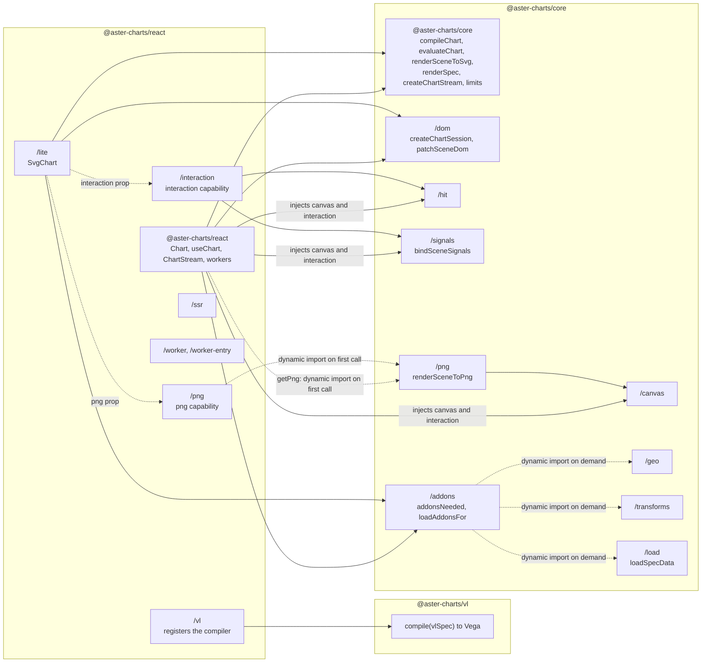
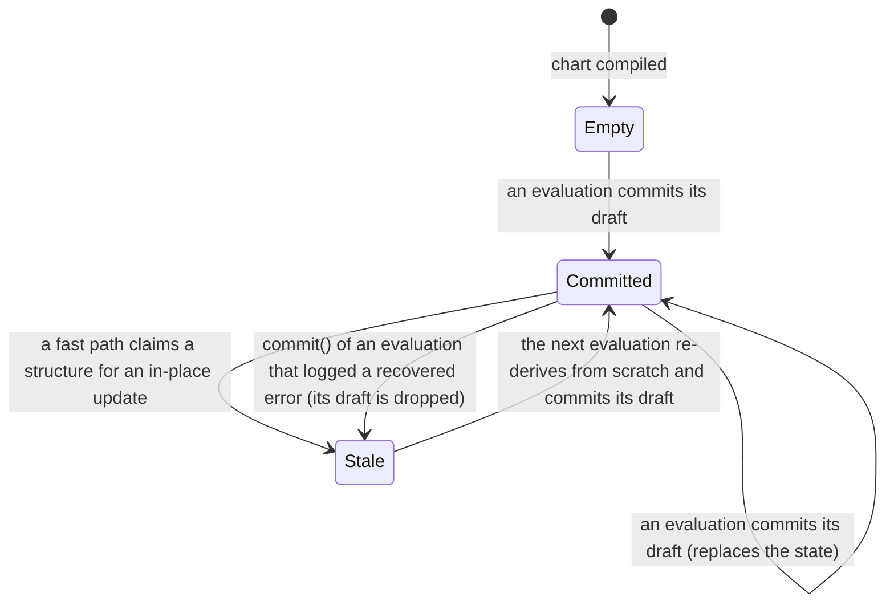
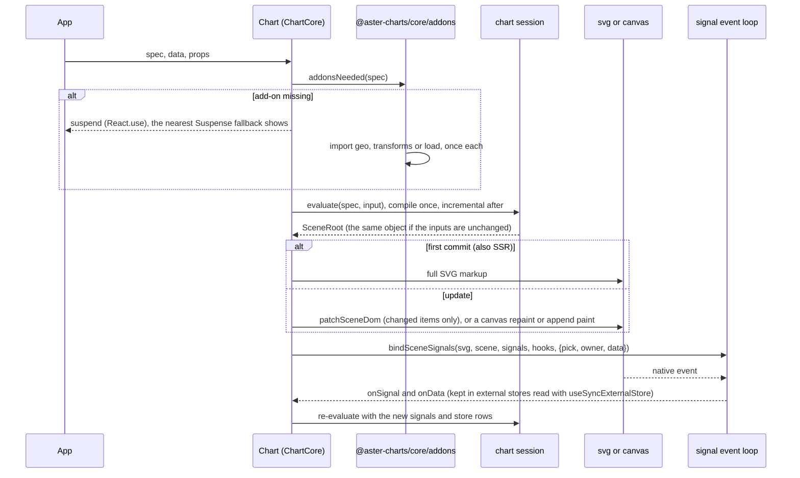

# Aster Charts Architecture

> **Status.** This document describes the code as it is. The runtime owns its whole stack
> ([ADR 0001](adr/0001-own-the-engine.md)): `@aster-charts/core`, `@aster-charts/react` and `@aster-charts/vl` import
> nothing from `vega-*`, `d3-*` or `topojson-*` (`pnpm check:deps` checks the sources and the built
> `dist`); the real Vega and Vega-Lite packages are the test oracle only. Measured results (corpus
> counts, sweeps, bundle sizes, benchmark ratios) are not repeated here: they live in
> [TESTING.md](TESTING.md) and [PERFORMANCE.md](PERFORMANCE.md), each next to the command that produced it.
> [ROADMAP.md](ROADMAP.md) lists what is still open.

## Overview

Aster Charts reads a Vega or Vega-Lite spec and produces a scene graph, then SVG (a string, or a DOM patched in place) or canvas pixels, and runs the signal event loop that makes the chart interactive. It is three packages, with no dependency on `vega-*`, `d3-*` or `topojson-*`.

| Package | Entry points | What it is |
|---|---|---|
| `@aster-charts/vl` | `.` | `compile(vlSpec)`: Vega-Lite to Vega. It does not import `@aster-charts/core`. |
| `@aster-charts/core` | `.` (the barrel: compile, evaluate, SVG string), `/addons`, `/geo`, `/transforms`, `/load`, `/dom`, `/signals`, `/canvas`, `/hit` | The engine. Heavy or optional parts are separate entries (see "Geo projections & the add-on boundary"). |
| `@aster-charts/react` | `.` (`<Chart>`, hooks, streams, workers), `/lite` (`<SvgChart>`), `/interaction`, `/vl`, `/ssr`, `/worker`, `/worker-entry` | The React bindings: one chart implementation (`ChartCore`) behind two shells. |



*Package map. Solid arrows are static imports. `<Chart>` imports the canvas and interaction capabilities itself; `<SvgChart>` imports neither and receives the interaction capability only through its `interaction` prop (dotted), and the PNG export only through its `png` prop. The add-on imports are dynamic and happen only when a spec needs them; the PNG painter (`/png`, with the canvas renderer) is imported by the first `getPng` call.*

**The render lifecycle** of a `<Chart>`: detect the add-ons the spec needs (and suspend until they are loaded), evaluate the spec in a chart session, write the output (full SVG on the first commit, a patch afterwards, or a canvas paint), then bind the signal event loop, whose signal and data changes feed the next evaluation. The sequence is drawn under "ChartCore and the two shells".

**Where to look**

| You want | Section |
|---|---|
| The three stages from spec to SVG | "Pipeline Overview" |
| Why an update equals a from-scratch evaluation, and where the state lives | "Incremental evaluation" |
| How SVG, the DOM patcher, canvas and hit testing share code | "Renderers, the DOM patcher and hit testing" |
| How expressions are parsed, refused and run | "Expression Engine" |
| What `@aster-charts/core/geo`, `/transforms` and `/load` register, and how they load | "Geo projections & the add-on boundary" |
| How `<Chart>` and `<SvgChart>` share one implementation | "ChartCore and the two shells" |
| Which files have import-time effects | "Side effects and tree-shaking" |
| Scales, transforms, SVG output and guides | "Scales", "Transforms", "Rendering" |
| How the oracle checks all of it | "Conformance" |
| Where Aster deliberately differs from Vega | "Deviations from Vega" (a reference table) |

The reference tables are the add-on table (under "Geo projections & the add-on boundary"), the side-effects table, and "Deviations from Vega"; the other sections explain how and why.

## Pipeline Overview

The rendering pipeline transforms a Vega (or Vega-Lite) spec into an SVG string through three stages:

```
VgSpec (JSON)
  ──compileChart──►  CompiledChart IR   ──evaluateChart──►  SceneRoot   ──renderSceneToSvg──►  SVG string
                    (packages/core/src/                   (packages/core/src/
                     compiler.ts)                           runtime.ts)
```

1. **compileChart** (`packages/core/src/compiler.ts`) consumes a Vega spec (`VgSpec`, an open record) and produces a `CompiledChart` IR containing typed arrays of data definitions, scale definitions, data transforms, mark definitions, axes, and legends.
2. **evaluateChart** (`packages/core/src/runtime.ts`) resolves the IR against `RuntimeInput` (data rows, width/height, signals). It resolves data, applies `CompiledTransform` operators eagerly, builds scale functions, and constructs a `SceneRoot` with `SceneGroup` / `SceneItem` nodes.
3. **renderSceneToSvg** (`packages/core/src/render.ts`) walks the `SceneRoot` tree recursively, dispatching on `marktype` (group, line, area, symbol, rect, rule, text, path, arc, shape, trail, image) to emit SVG elements.

The scene shapes (`SceneRoot`, `SceneGroup`, `SceneItem`, `SceneNode`) are defined in `packages/core/src/types.ts` and intentionally mirror `vega-scenegraph`'s JSON structure so the conformance oracle (real Vega, rendered headless) can be compared structurally.

Vega-Lite input is a separate step in front of this pipeline: `@aster-charts/vl`'s `compile(vlSpec)` emits a Vega spec, which then follows the three stages above. `<Chart>` does this through the opt-in `@aster-charts/react/vl` add-on; `renderSpec` takes Vega only.

Public API:

```ts
import { renderSpec, compileChart, evaluateChart, renderSceneToSvg,
         compileExpr, buildScale, applyTransforms } from '@aster-charts/core'
```

## Incremental evaluation

**Guarantee.** For any spec and any sequence of updates (value changes that grow or shrink a domain, row inserts/removes/reorders, length changes, signal and size changes, `changedDatasets`, `dataChanges`, `dataPulse`, session `evaluate`/`change`), the scene an incremental or streamed update produces deep-equals `evaluateChart(compileChart(spec), input)` built from scratch at that step. This is a correctness guarantee, not a best-effort optimisation: `packages/core/src/incremental-oracle.test.ts` generates random specs and update sequences and compares every step with a freshly compiled chart (`ASTER_ORACLE_SEEDS=2000 pnpm vitest run packages/core/src/incremental-oracle.test.ts` for a long sweep; a failure prints the seed and a shrunk step list).

**State model.**

- The compiled IR (`CompiledChart`) is immutable. `evaluateChart` never writes it: derived signal values, resolved multi-dataset scale domains and the `category` range are per-evaluation (or resolved once at compile time).
- Everything an evaluation remembers lives in one `IncrementalState` per compiled chart (`runtime.ts`): the previous final scales (plus their min/max or value census), each dataset pipeline's per-step outputs and indexes, and the previous top-level mark groups keyed by compiled-mark identity.
- An evaluation reads the committed state and builds a fresh draft. The draft becomes the committed state exactly once, after the evaluation succeeds (`evaluateChart`) or after the session's limit checks pass (`evaluateChartPending(...).commit()`). The few fast paths that update a structure in place for O(changed) cost first *claim* it, which flags the committed state stale: an evaluation that dies before committing can never leave a half-updated state behind (the next evaluation re-derives from scratch).
- A claim is by identity: the structures a fast path writes (a dataset's state, its steps' rows and step state, a domain census) go into the evaluation's `claimed` set, and a fast path that finds one of its structures there runs from scratch instead. Two states can hold the same structure (kept steps are shared, not copied), so a structure is updated in place at most once per evaluation, whichever state it was reached through.
- A view that fits its viewport (`autosize` fit / fit-x / fit-y, and a view sized by a measured container) makes two passes: the first at the viewport finds the overflow, the second builds the content at the viewport less it. The committed state is the second pass's, and it carries the first pass's draft (`fitFirst`). The next evaluation makes its first pass from `fitFirst` and its second from the committed state, each told what changed, so both passes are incremental against a pass of the same size. When the fitted size moved, the second pass finds a state of another size: its fingerprints differ and it re-derives what reads the size, as any resize does. A first pass with nothing of its own to start from (the evaluation before made one pass, or its first pass logged an error) starts from the committed state, as the second does. A view with an injected `random` source and a dataset that may draw from it is the one exception: its first pass keeps starting from the committed state, because the engine's pulse path draws without a tape, so which pass takes a pulse decides which numbers the source hands out. Keeping both passes' state costs memory: a fit view retains the first pass's scene items as well as the second's. The view's id counter is always the committed state's. Pinned by `fit-incremental.test.ts` and the container scenario of `incremental-oracle.test.ts`.
- Reuse is keyed by what a result actually depends on: the evaluation context (signals incl. `width`/`height`, `domainRaw`, text metrics; typed and structural, so an unchanged `[0, width]` derived signal is unchanged), every dataset the unit reads (closed over `source` chains, `lookup.from` and `data()`/`indata()` expressions), and each scale it reads (by object identity).
- Mark groups are matched to the previous scene by compiled-mark identity, never by source dataset or name. Group marks (facets, trellises, scoped groups) are made again on every evaluation; the leaf marks inside their items are matched by instance (see "Marks inside group items"), and what the evaluation makes the same as before is the node it made before (`shareContent`).
- **Signal-scoped reuse.** A top-level scale and a top-level leaf mark are keyed by the signals they read, not by every signal, so a signal that changes keeps everything that does not read it (a Vega-Lite `time` animation's clock ticks without re-encoding its marks).
  - **What a result reads.** Its key (`readsKey` in `runtime.ts`) holds the values of every name its definition mentions (every identifier in every string of the scale or mark, expression or not, read as the expression lexer reads it: an escaped name is the name it stands for, a name past ASCII is whole -- `namesIn` / `lexedText` in `step-reuse.ts`; a superset of the signals it reads, since an expression reads a signal by its name and the expression functions are never handed the signals), the view's `width` / `height` / `padding` / `autosize` / `background` and the view's size (read without being named: `range: "width"`, `{field: {group: "width"}}`), the inputs of the context fingerprint (`domainRaw`, text metrics, container size), the registered expression functions, and for an image or a link the URL policy.
  - **What reads every signal.** These keep the whole context fingerprint, as every result did before: a mark with transforms (a `label` reads other marks, a `force` or a word cloud may draw, a geo transform reads a projection), a mark that reads the items of another mark or a dataset's hierarchy (`treePath`, `treeAncestors`), a scale or mark that calls `now`, `random`, the window or a geo function, or names a projection, and a scale whose parameters read a dataset, a hierarchy or a scale from an expression.
  - **Datasets a mark reads by name.** A mark whose expressions read datasets by the names they spell out (a selection test, `vlSelectionTest("brush_store", datum)`; `data`, `indata` and the other selection functions: the expression compiler refuses any first argument but a string literal, as vega's does) is keyed by the signals it names and by those datasets' rows (`datasetKey`: their content up to what a fingerprint takes in, 512 values; past it the array, when the caller tells every change and did not name the dataset as changed; otherwise a key equal to no other). A brush's or a hover's points are kept while the store's rows and the signals they name are as they were, and run a pulse like any other mark.
  - **The datasets it reads.** When the signals changed, a dataset a result reads may have changed with them, though no caller said so. A scale is kept only when every dataset it names is the very array of the evaluation before (`sameRows`: a dataset re-derived since is a new array; a kept step, a kept copy and the host's own array are the same). A mark is kept when the datasets it names are, or when its `from` rows are equal, row by row and field by field, to the rows its items were made from (`sameData` against each item's `datum`, which is a copy made when it was encoded): a filter that runs again and keeps the same rows keeps the mark.
  - **When.** Only when the caller says what changed or follows the session's contract (`DataStability`: an array it gave before holds the rows it held), not under `limits` (a kept result is not counted against them again), and only in a pass where nothing failed so far (a dataset or a scale that throws stops vega's run before the marks). With the whole context unchanged, the rule is the one before: a dataset the caller did not name is unchanged.
  - **Builds of a dataset kept between rounds and passes.** A pass builds its datasets again once the signals that read data resolve (`prepareChartCtx`: every Vega-Lite selection has one, `vlSelectionResolve`), and a view that fits its viewport makes a second pass. A dataset with transforms whose input arrays are the same and whose steps read the same (`pipelineKey`: every step's keys, its signals and the datasets it reads by name) is the build the round, or the pass, before made (`keptBuild`): its rows, the numbers its `identifier`s drew (the view's id counter is set where that build left it, and the build is kept only from where it started), the signals its steps published, and its pulse -- handed to another pass only when that pass's items were made from the same state of the evaluation before (`BuiltDataset.base`). A dataset with no transforms keeps the copy the round or pass before made of the same arrays. A Vega-Lite point selection's dataset (an `identifier` step) is therefore the array it was across a signal change, and the scales over it are kept. Not under `limits` (each round's rows count against them, as when it ran), not for a step that draws, and not in a view with an injected `random` source and a dataset that may draw (which build takes a pulse decides which numbers the source hands out).
  - **A pulse with a signal change.** A dataset runs a pulse through its steps when they read what they read when its state was made (its `pipelineKey`), whichever other signals changed; it used to need the whole context unchanged. A scale whose key is unchanged advances its census over the pulse, and a mark whose key is unchanged splices its items, so a row appended while a hover moves encodes one item. After a pulse, the state records what each step read (unless a step publishes a signal), so a later evaluation that is not driven by a pulse keeps the steps. A filter whose expression reads a scale, or a dataset the update changed (`length(data("t"))` over its own source, a selection's store edited with the rows), judges every row again: its verdict on a row is not the row's alone.
  - **What stays conservative.** Group marks (facets, concat cells, scoped groups) and guides are made again on every evaluation (the leaf marks inside group items are kept as "Marks inside group items" says, and unchanged nodes are shared); a scale with a `{signal}` domain or range that reads a dataset or a scale; a mark with transforms; a dataset with a step outside `step-reuse.ts`'s list (lookup, geo, hierarchy, label, force, ...), whose builds are run again in every round and whose pulse needs the whole context unchanged. An ordinal scale that adds the categories it is asked for to its domain (`domainImplicit`, a `domainRaw`, or no domain) is made again on every evaluation, and so are the marks that read it. A mark that lays out nodes with a `force` that has a `link` force, and every mark drawn from or reading that force's link dataset, is made again on every evaluation (`forceBound`): each run of the force rewrites the link rows. A scale is not kept under `limits` for its settings alone (see "Discrete scales over changing rows").
  - **Pinned by.** `signal-reuse.test.ts` (fresh equality and the reuse itself, by identity and by the items encoded, per kind of read; scopes, facets, guides, a fit view, failures), `selection-reuse.test.ts` (point selections over numbered rows, selection tests, kept builds, the id counter, pulses with a signal change, escaped names, limits, drawing steps), `packages/conformance/test/vl-signal-reuse.test.ts` and `vl-selection-reuse.test.ts` (a Vega-Lite `time` animation, a point selection also in a container-fit view, an interval brush, a legend-bound selection, a brush filtering a concat view and a point selection in a facet, end to end), besides the oracle and the incremental differential.
- **Marks inside group items.** A leaf mark inside a group item (a facet's cell, a concat's view, a line per category, a group per row of a dataset) is recorded by its instance: the marks and the keys of the group items above it (`GuideScope.keyPath`: a facet's partition key, a row's index), not their order (`evaluateInstanceMark`).
  - **Kept.** The evaluation after keeps it when its key (`markKeyOf` in the item's scope, over the names it mentions: a facet's partition is a dataset of the scope, not a mark's name, `readsAllDataInScope`), the scales it reads, the other datasets it names or reads by name (as arrays), and the item's box (and, for a mark with a `{group}` or `{parent}` field reference, the item's datum, `parent` and encode, by value) are as they were, and its rows are equal, by value, to the data its items were made from (`diffRows` over the items' `datum`, in row order: a sorted mark keeps its row order apart, `ROW_ITEMS`).
  - **Spliced.** Rows that differ where they are (an append, an edit, a removal, a move) splice its items: the rows the diff pairs keep their items, the others are encoded, into a new array (the items before are never written).
  - **Made again.** A mark with transforms, one bound to a force's links, one that reads datasets from an expression whose name it computes, a pass that failed or was cut, and an evaluation under `limits`.
  - **Shared nodes.** Once the view is laid out, every item of a group mark in its content, and every node inside one, that is the same, by value over every own property, as the node at its place in the content the pass before made is that node (`shareContent`, `sameNode`; a leaf mark's group only by identity): an unchanged cell keeps its identity with its guides and title, and a changed cell keeps those of its children that did not change. The view's own guides and title are not compared (a chart with no group mark would pay for it on every evaluation): they are made again, as before.
  - **Cost.** Each kept or spliced mark compares its rows with its items' data: O(rows) per evaluation, instead of encoding them.
  - **Pinned by.** `group-reuse.test.ts` (four kinds of group × the kinds of change: the fresh scene, items and cells kept, items encoded; each read a kept mark depends on, one at a time) and the facet, concat and line charts of `vl-discrete-scale-reuse.test.ts`.
- **Discrete scales over changing rows.** A scale whose key is unchanged (`stamp` in `buildScales`) is kept over changed rows by one of three routes, and made again otherwise:
  - **Nothing it names changed.** Every dataset the scale names (its domain's and its range's) is unaffected, and it reads no dataset or scale from an expression (`scaleReadsOf`).
  - **A census.** A scale of one dataset's field that names no other dataset advances a census over the pulse of that dataset: the min/max of a continuous domain (`advanceContCensus`), or, for a band, point or ordinal domain unsorted or sorted by key (`sortReadsCategoriesOnly`), where each category, told apart by its text as the domain tells them, first appears (`advanceDiscCensus`). A discrete census advances over a pulse that keeps every row's index (rows edited in place, rows appended, also after a filter, which publishes an append as an append) in O(changed + appended): the domain is unchanged when no category appears or goes and no category's first row moves or changes value. It stores one value per row and one index per category.
  - **Its settings.** Otherwise (a pulse with an index mapping, a sort by count or by an aggregate, several fields or datasets, a domain or range from an expression, `domainRaw`) the settings the scale is made from are read again, as a fresh build reads them (`scaleSettings`), and the scale of the evaluation before is kept when they are the same (`sameSettings`: the same keys in the same order, `Object.is` leaves, so `0` and `-0` and two Dates of one instant differ). A band, point or ordinal scale under a `domainRaw` leaves its data's domain out of the comparison: the override is its domain. This costs the domain's O(n) scan, which a scale made again also costs, and spares the marks that read it.
  - Kept, the scale is the same object, so a mark that reads it splices the items of its rows' pulse. Not under `limits` for its settings (a scale made again is checked against ceilings the limits may no longer raise), and never for an ordinal scale that grows on lookup.
  - **Pinned by.** `discrete-scale-reuse.test.ts` (six scale kinds × seven pipelines × ten sorts × the kinds of change, and domains of several fields, datasets and a literal: every step is a fresh evaluation's scene and scale, and the scale is kept exactly when a fresh evaluation's scale is unchanged), `packages/conformance/test/vl-discrete-scale-reuse.test.ts` (Vega-Lite charts end to end, and a stream's appends), `ChartStream.test.tsx`, and the row changes of `pnpm conformance:diff` over the corpus.



*The committed state of one compiled chart. An evaluation reads it only while it is `Committed`; from `Empty` and `Stale` it starts from nothing. A draft belongs to one evaluation and is not a state of the chart: an evaluation that throws before it claims anything leaves `Committed` as it was.*

**Scenes are never observably mutated after they are returned.**

- A structural update (insert/remove/reorder) builds a new items array. An append or same-length edit advances the engine-owned array in place (O(changes)) and hands it to the new group; the superseded group's `items` becomes a lazy snapshot (old length plus the overwritten items) that materialises on first read and composes across a chain, so earlier scenes can be read in any order, or never.
- Newer groups never reference older ones (an unreferenced old scene is collectable); an old scene that is retained but never read keeps one small undo record per later update alive.
- Always read `group.items` through the group: an array reference captured earlier is the engine's live array.
- The other live link is `scene.runtime` (the signal event loop's expression runtime), which reads the chart's datasets as they are *now*.

**Transforms.** Same-length and length-changing updates go through one engine (`applyStepWithPulse`, in `incremental-engine.ts`): a same-length pulse is an append-only pulse that appends nothing. Per-transform fast paths exist for row-local transforms, `filter`, `fold`, `flatten`, `aggregate`, `joinaggregate`, `collect`/`sample`, `identifier`; `window` (which writes results in source order) and `stack` re-derive and are compared row by row; everything else re-derives. A transform is row-local only when its output row depends on nothing but its input row. A step that publishes a signal (`extent`, `bin` with `signal`) records the value it left (`DatasetState.published`); when a pulse makes it publish another value, the steps after it run over every row, since a later step may read it (a `formula` over an `extent`). An `identifier` after a `filter` numbers each row as its source row, the row of the pipeline's input it is, as `runPipeline` does: a source row keeps its number while it lives, through the filter or not (`SourceNumbers` in `identifier-ids.ts`). A pulse follows which source row each row is through the steps, using the pass flags each filter leaves (`sourcesAfter` in `tuple-order.ts`). An append follows only the rows it added. Any other pulse follows every row, and finds the source rows among the run before's as an update with no pulse does. A pipeline with a step other than a filter, or one that keeps its rows, before an `identifier` that follows a filter runs without a pulse. Pinned by `identifier-pulse.test.ts` and, against Vega, `identifier-order-vs-vega.test.ts`.

**Kept steps.** An evaluation that is not driven by a pulse (a resize, a signal write, a replaced array whose rows are equal) does not run every dataset pipeline from its first step: it keeps the steps whose reads are unchanged.

- **Which steps.** A step of `step-reuse.ts`'s list (formula, filter, bin, timeunit, extent, crossfilter, resolvefilter, aggregate, joinaggregate, window, collect, identifier, project, fold, flatten, stack, impute, pivot, sample, sequence) reads its input rows, the signals its parameters and expressions mention (found in the expression tree; a call outside the pure functions, `event`, `item` or a malformed expression keeps the step out of the list), the datasets its expressions read by a name they spell out (`data("store")`, `indata`, `vlSelectionTest` and the other selection functions: by their rows' content, or by the array past what a fingerprint takes in), the injected random source and, for `identifier`, the numbers the committed evaluation gave.
- **When a step is kept.** `runPipeline` records those reads when a step runs, and a pulse through a pipeline whose steps' reads are all known records them too (unless a step publishes a signal); the next evaluation keeps the step (its rows, its state, the signal it published, the Box-Muller carry-over a drawing step left) when they are as they were over the same input rows.
- **Input rows** are recognised by identity: the arrays of a derived dataset's sources, and for a host dataset the array the committed state was made from, which the session vouches for (`stableData`: by content when it diffed the rows itself, by identity when it did not look; a dataset named as changed never).
- **Kept copies.** A dataset with no transforms over the host's rows or a source's holds copies of them; it keeps the copy the evaluation before made while those rows are recognised as above (`keptCopy`), so what is made from it is the same array too.
- **Scoped datasets.** Datasets of group scopes are kept as whole pipelines over the same source arrays and signals (`runScopedData`).
- **Runs of steps.** Consecutive formula / bin / timeunit steps that cannot tell the difference run as one over one set of rows (`runsOf`); the earlier steps of such a run stand for the rows the last made, so the incremental engine compares them without the fields the later steps added (`aliased`).
- **Pinned by.** `dataset-reuse.test.ts` pins all of it against an engine that keeps nothing, `differential-step-reuse.test.mts` against real Vega.

**Where the engine lives.** In short: the engine is `incremental-engine.ts`, and it is passed to the evaluation as an argument instead of being registered.

- The incremental step engine (`incremental-engine.ts`: the pulse-driven step functions, and the state a step leaves for the next pulse) is not part of `runtime.ts`, which only declares its shape (`IncrementalEngine`).
- The kept steps (`runPipeline`, `runScopedData`) stay in the runtime: a view that builds its datasets again under signals that resolved since keeps the steps of the first build, in a single evaluation.
- `runtime.ts` evaluates a chart once: `evaluateOnce`, which `renderSpec` and `getChartInfo` run, reads nothing from an earlier evaluation of the chart and leaves no step state for a later one.
- An evaluation that keeps its state for a later one, `evaluateChartPending`, is handed the engine by its caller: the public `evaluateChart` (`evaluate.ts`) and the chart session (`session.ts`, so every stream and React shell) import it and pass it.
- The engine is an argument, not a registration, so it needs no `sideEffects` entry and no bundler setting can drop it, and a bundle of `renderSpec` alone does not contain it (`scripts/check-bundle-shaking.mjs` and `scripts/verify-publish.mjs` pin both directions).
- An evaluation that keeps state and is given no engine does not fall back to anything else: it throws.
- **Pinned by.** `evaluate-once.test.ts` pins that `evaluateOnce` makes what `evaluateChart` makes of a chart evaluated for the first time, over generated charts.

## Renderers, the DOM patcher and hit testing

**One attribute list per element.** `render.ts` defines, for every SVG element the scene produces (symbol, rect, line, area, trail, text, arc, path, image, guide leaves, frame, background, gradients, clip paths), one `*Attrs(item, sink)` function.

- The string renderer (`renderSceneToSvg`) writes it through `StringAttrSink` (escaped `name="value"` text, the single `escAttr`/`escText` writer).
- The DOM descriptor builder (`dom.ts`) writes the same function through `PairAttrSink` (`[name, value]` pairs for `setAttribute`).
- Neither side owns a list of its own, so they cannot drift; `dom.ts` only decides structure (nesting, clip registration, per-item descriptor caching, `denseMarks` batching, which deliberately does not mirror the string output).
- The paint of every element (fill, stroke, dash, cap, join, opacity, blend: vega's `stylesAttr`) is one function, `paintAttrs`, so a paint property cannot be dropped by one mark kind or one renderer; text geometry (`textItemDesc`), item transforms (`rotateItemTransform`/`transformItemTransform`), the frame (`frameBackgroundPath`/`frameItem`) and the d3-arc port (`arcInto`) are shared with the canvas painter.
- Clip ids are content-addressed (`svg-defs.ts`), so a descriptor never depends on traversal order.
- **Pinned by.** `packages/conformance/scripts/dom-string-parity.test.mts` enforces it over the whole conformance corpus with no allow-list, and `dom-regressions.test.ts` over hand-built scenes for what the corpus lacks.
- The canvas painter still has its own paint code; `canvas.test.ts` and the Chromium canvas gate compare it with the SVG output.

**The DOM patcher** matches children by position. A reused item keeps its cached descriptor (`clean`), and a clean descriptor is only skipped when the element it lands on was last patched with that very descriptor; after a removal or reorder it is compared and written like any other (`dom-oracle.test.ts` checks patched DOM against a freshly built one over random insert/remove/reorder sequences, per-item and dense).

**Canvas append painting** (`renderSceneToCanvasAppend`) paints only appended marks over the previous frame and returns `false` (caller repaints in full) unless the result equals a full repaint: every existing item is untouched (same array lineage, no `__editGen` stamp, no newer `__gen` under a reused group object), every guide is unchanged (the context has no clear, so a changed guide would ghost), and the appended marks cannot land on paint a full repaint draws above them. `canvas-append-oracle.test.ts` (recorded paint) and the second phase of `pnpm conformance:canvas` (real Chromium pixels) check it over random session and stream sequences.

**The hit index** (`@aster-charts/core/hit`) picks against the geometry the renderers paint: the flattened fill/stroke outline of arcs, paths, shapes, geoshapes, areas, lines and trails, the symbol's own shape and rotation, the rounded rect outline, and text from the layout's text bounds rotated about its anchor. Points within 2px of painted geometry count as hits (pointing slack). Cell ranges are clamped to the grid and entries covering many cells are kept in a short side list, so no item can make the index allocate without bound. `hit-geometry.test.ts` checks it against geometry taken from the canvas renderer.

## Expression Engine

Expressions (formulas, filters, signal updates, mark encodings) are parsed by `packages/core/src/expr-parser.ts`
(an on-demand lexer and a precedence-climbing parser that accept and refuse exactly what `vega-expression` does,
with its diagnostics, producing a plain ESTree-shaped tree) and compiled once into closures by
`packages/core/src/expr-interpreter.ts` (the semantics of `vega-interpreter`, with Aster's stricter sandbox).
Nothing is compiled with `new Function` or `eval`. The function table the interpreter calls lives in
`packages/core/src/expression.ts`; it mirrors the documented `vega-functions` surface and is bound to the
runtime's scales and data, to the owned type/array/string/math utilities (`util.ts`), colour spaces
(`color.ts`), calendar (`time.ts`) and format layer (`format.ts`, `time-format.ts`, `locale.ts`):

| Group | Functions |
|-------|-----------|
| Scale / projection / data | `scale`, `invert`, `domain`, `range`, `bandwidth`, `bandspace`, `copy`, `data`, `indata`, `pluck` |
| Date-time | `year/quarter/month/week/day/date/hours/…` (+ all `utc*` variants), `datetime`, `utc`, `time`, `timeOffset`/`utcOffset`, `timeSequence`/`utcSequence`, `dayofyear`, `timezoneoffset`, `now` |
| Array | `extent`, `clamp`, `lerp`, `sequence`, `slice`, `reverse`, `sort`, `join`, `peek`, `span`, `inrange`, `clampRange`, `indexof`, `lastindexof` |
| String | `truncate`, `pad`, `upper`, `lower`, `split`, `trim`, `replace`, `substring`, `test`/`regexp`, `parseFloat`/`parseInt` |
| Color | `rgb`, `hsl`, `lab`, `hcl`, `luminance`, `contrast` |
| Formatting | `format`, `timeFormat`/`utcFormat`, `timeParse`/`utcParse`, `timeUnitSpecifier`, `month*`/`day*` |

Hosts add functions with `registerExpressionFunction` (vega's `expressionFunction`); see [API.md](API.md).

### Expressions are refused at compile time, as `vega.parse` refuses them

`compileChart` reads every expression of the spec before anything runs (`spec-expressions.ts`, called with the merged config) and throws a `SpecParseError` with vega's message for the first one vega's parser would refuse; the engine never gets as far as evaluating a spec with a syntax error, an unknown function or an undeclared signal.

- **Walk order.** `spec-expressions.ts` walks the spec in the order vega-parser reads it (a scope's signals are known first, then projections and scales, data sets with their transforms, signals with their handlers, axes, marks, legends, the title, and the `{signal: text}` lambdas last) and keeps what the scope knows at each point (its signals and scales, those of the scopes around it, a group's `parent`, the signals transforms declare as they are met).
- **Site text.** The text of every site is built the way vega builds it (an encode entry, a rule list, a data trigger, the filters of a stream), because a syntax error quotes that text.
- **One text.** `expr-check.ts` is the check of one text: parse, the calls that must name data or a scale, the code generator's refusals in tree order (unknown function, illegal callee, arity), and last the free names against the scope.
- **What vega reads.** Two tables say what vega reads: `transform-params.ts` (the parameters of each transform in the order of its definition, with the kind of each; a key the definition does not list is never read) and `guide-model.ts` (which properties of an axis, a legend and the title vega reads, as what, and in which marks the guide has; the size expression and the layout a symbol legend writes out).
- **Which functions exist.** `expression.ts` answers "does vega know this function" (`isExpressionFunction`): the built-ins, the registry (host and add-ons), the add-ons' table (`addon-functions.ts`, so a function of an add-on that is not loaded yet is accepted by the compile and asked for by `@aster-charts/core/addons`, which reads the same expressions, before the first evaluation) and the functions vega has that Aster has not written.
- **Bind time.** What remains for bind time is what only a running chart knows: a function removed after the compile is reported by `signals.ts` to the logger while the other handlers still bind.
- **Pinned by.** The live differentials are `differential-parse-errors.test.mts` (every site of `expression-sites.mts` against `vega.parse`), `differential-expression-functions.test.mts` (every function name), `differential-transform-params.test.mts` (the table of transform parameters against the definitions of the pinned vega) and `jsdom-parse-errors-handlers.test.mts` (the handlers, compile and bind).

### Signals

Signals are values in the evaluation context. Signal `update` expressions are resolved to a fixed point in the runtime
(`resolveSignalUpdates`), so a scale range/domain or an encoding can reference a derived signal. Event-driven
`signal.on` handlers are real: `@aster-charts/core/signals` reimplements the behaviour of `vega-event-selector` (its own `event-selector.ts`), `vega-view` and
`vega-runtime` that turn DOM events into signal updates (selectors, `between`, filters, `throttle`, `consume`,
`markname:event`), and `<Chart>` re-evaluates the scene when a signal changes ([INTERACTION.md](INTERACTION.md)).
A signal written into a running chart renders like Vega except in the `retained` cases described under
"Deviations from Vega" below.

## Config & style resolution

`compileChart` reads `spec.config` and applies it as encode/property defaults (encode always wins): `config.background` → root background, `config.view` / `config.style.cell` → frame stroke (a `transparent` stroke serializes as *no* stroke), `config.style.<marktype|name>` → mark encode defaults (e.g. a `rect` style's `fill`/`cornerRadius`), and `config.axis` / `config.legend` → guide defaults. The chart `title` (string or object, with `subtitle`) merges from `config.title` and the vega-theme style defaults (fontSize 13, bold, offset 4, subtitlePadding 3).

## Geo projections & the add-on boundary

`packages/core/src/geo.ts` builds projections (`mercator`, `albers`, `albersUsa`, `equirectangular`, `orthographic`, …) from the compiled `projections` spec the way vega's Projection transform does, resolving `scale`/`translate`/`center`/`rotate` signal params against the runtime; the `geoshape` transform and shape marks route geometry through the projection's `GeoPath` (`geo-path.ts`; a path with no projection draws coordinates as they are).

The geo engine is Aster's own design and matches d3-geo/vega bit for bit (the generated differential pins it, see TESTING).

- **Pipeline.** A GeoJSON object is flattened once into an **event buffer** (`geo-events.ts`: points, line and polygon starts and ends, the sphere), and every stage is a pure function from one buffer to another: rotation and clipping to the visible sphere (`geo-clip.ts`: antimeridian cut, small-circle cap, cut pieces re-joined into rings along the clip boundary), projection with adaptive resampling (`geo-resample.ts`), clipping to the screen rectangle.
- **Projections.** A projection (`geo-projections.ts`: raw projection formulas in `geo-raw.ts`, plus scale/translate/centre/rotation/clip state) offers `project`/`invert` for one position and `planar` for a whole buffer; the path string and the planar measures (`geo-path.ts`) and the spherical measures (`geo-sphere-measures.ts`) are folds over the final buffer. No state outlives a call.
- **Hot loops.** The hot loops are written for a cold start, where compile time is most of a render: each stage walks its buffer in batches of 128 events through one method (a loop that runs long inside one call is compiled twice by V8), methods and not per-instance closures are the call targets (a closure that changes between calls deoptimises its caller), a ring that crosses neither the antimeridian nor a pole is passed through the sphere clip, and a buffer that lies strictly inside the clip rectangle is passed through the rectangle clip.
- **Event indices.** Events carry the index of the input event they descend from, which is how the three parts of the albersUsa composite are interleaved back into the order a streaming pipeline would have written them.

**Projections that fit data.** A projection with `fit` reads its extent from datasets and signals (`data('a')`, a `geojson` transform's signal), so the runtime keeps a projection registry: it rebuilds a projection when a dataset or signal it was fitted to changes (an epoch counter), builds datasets on demand when a fit needs one that has not been evaluated yet, and treats `geopoint` / `geoshape` as not row-local when their projection fits (a row's pixels depend on all rows). The `geojson` transform publishes its collection as the signal it names. `geoshape` reads its feature from the item and measures the path with an unrounded bounding context (`projectedBounds`, a lazy thunk on the item), because vega's group layout uses unrounded bounds and a rounded path would shift a concat grid by a pixel.

Because heavy feature areas are only used by a small fraction of specs, they are **not** reachable from the `@aster-charts/core` barrel. The core code paths consult injection registries (`packages/core/src/registry.ts`: `geoRegistry`, `transformRegistry`, `dataFormatRegistry`); opt-in entries register their implementations (or, for `canvas`, `hit` and `addons`, provide a capability a plain chart does not need):

| Add-on | Registers |
|---|---|
| `@aster-charts/core/geo` | the projections (`buildProjection`, `projectedPath`) and the contour generator (`contourRun`) |
| `@aster-charts/core/transforms` | the transforms that are not in the core dispatch: every type of `TRANSFORMS_ADDON_TYPES` (exported from `@aster-charts/core/addons`, the one list; it includes `pie`, `cross`, `countpattern`, `dotbin`, `geopoint`, `geojson`, `linkpath`, `crossfilter` and `resolvefilter` besides the layout transforms) (implementations in `transform-extra.ts` (`voronoi` on `delaunay.ts`, `voronoi.ts` and `orient.ts`), `hierarchy-nest.ts` (`nest`), `hierarchy-layout.ts` with `circle-pack.ts`, `treemap-tiling.ts` and `hierarchy-tree.ts`, `force-layout.ts` with `quadtree.ts`, `raster-transforms.ts`; `label.ts` places labels as vega-label does, on an occupancy grid, and `label-draw.ts` draws the marks it avoids with `raster.ts`, a coverage-only 2D context that follows Skia's rasterizer, so it needs neither a canvas nor a DOM), and the distribution functions of the expression language (`quantileNormal`, `densityUniform`, ... in `stats-functions.ts`) plus `treePath` / `treeAncestors` |
| `@aster-charts/core/load` | the data-format readers (`csv`/`tsv`/`dsv`/`topojson`; `dsv.ts`, `topojson.ts`) and `loadSpecData`, which vets every URL against a policy (protocols, credentials, private hosts, redirects, size and time bounds), fetches each `url` dataset and inlines its values so the synchronous pipeline runs unchanged ([LIMITS.md](LIMITS.md)) |
| `@aster-charts/core/dom` | the incremental DOM patcher (`patchSceneDom`, `sceneToDomDesc`, `createChartSession`); `<Chart>` now defaults to this path |
| `@aster-charts/core/signals` | the signal→view event loop (`bindSceneSignals`, `stampDatumAttrs`) that binds a spec's `signal.on` streams to the rendered svg, and the timer clock seam (`setTimerClock`) |
| `@aster-charts/core/canvas` | the canvas renderer (`renderSceneToCanvas`) |
| `@aster-charts/core/png` | a scene as a PNG (`renderSceneToPng`): the canvas renderer's paint, encoded by the platform canvas, the scene's image marks loaded with CORS first; `getPng` imports it on its first call |
| `@aster-charts/core/hit` | the hit index (`buildHitIndex`) |
| `@aster-charts/core/addons` | which add-ons a spec needs and loading them on demand (`addonsNeeded`, `loadAddonsFor`), and `TRANSFORMS_ADDON_TYPES`, the list of transform types the transforms add-on registers |

**Add-ons load themselves.** A host that knows what its specs need imports the add-ons (`import '@aster-charts/core/geo'`); the shells and hooks also load them on demand, so a spec renders with nothing imported.

- **Detection.** `@aster-charts/core/addons` reads the spec's structure (a transform of the transforms add-on, a `contour` transform or a `projections` entry for geo, a `csv`/`tsv`/`dsv`/`topojson` format for load, in `data` and in every mark's `data` / `transform` at any depth, and an add-on's expression function such as `treePath` in any expression, found by parsing it with the engine's own parser; no evaluation, no regular expression, cached per spec object) and imports exactly those, each at most once; an add-on the app imported itself is recognised by what it registered and never imported again.
- Test: `packages/conformance/src/addons-needed.test.ts` checks the detector against the engine itself over every corpus spec (the add-ons discovered by loading one at a time on each "load the addon" failure are exactly the ones named, and a render with just those equals a render with all).
- **In React.** The React wait is a Suspense wait (`React.use`), like an async `spec` and `useSpecData`: `<Chart>`, `<SvgChart>`, `useChart`, `useChartStream`, `<ChartStream>` and the worker hooks suspend until the add-ons are there (a `<Suspense fallback>` above the chart shows something meanwhile; with none the new root commits when the chart is ready; to keep an existing chart on screen while a changed spec's add-on loads, update inside `startTransition`), render the same document the static path renders, and report a failed import through `onError` / the hook's `error`, once. A spec that needs no add-on never suspends and imports nothing, and an app that imported the add-on itself never loads it twice.
- **Synchronous entry points.** The synchronous entry points (`renderSpec`, `renderChartToStaticMarkup`, `hydrateChart`) cannot wait and keep the actionable error; `loadAddonsFor(spec)` is the awaitable step for them. Server rendering: `renderToPipeableStream` and `renderToReadableStream` wait for the import and send the chart; `renderToString` renders the `<Suspense>` fallback (the client renders the chart), so `await loadAddonsFor(spec)` (or a static `import '@aster-charts/core/geo'` in the server entry) before it, and before `renderChartToStaticMarkup` and `hydrateChart`.
- **In a worker** the entry (`@aster-charts/react/worker-entry`) imports what a message's spec needs before it handles it, in arrival order; the main-thread fallbacks of the worker hooks wait the same way.
- **Vega-Lite.** The Vega-Lite compiler stays an explicit import (`@aster-charts/react/vl`).
- **Data.** Data is never fetched on its own: a `url` dataset is still resolved by `loadSpecData` / `useSpecData` (a fetch is the host's decision, under its URL policy), only the readers for its format load by themselves.
- **Bundles.** Bundlers split the add-ons into chunks fetched on demand; the bundle budget counts what loads up front.

`@aster-charts/react/vl` is the same pattern at the grammar level: the Vega-Lite compiler (`@aster-charts/vl`) is registered by `import '@aster-charts/react/vl'`, so Vega-only hosts do not pay for it. A spec that needs a gated feature without its add-on loaded gets an actionable error naming what to import first. `packages/benchmarks/scripts/budget.mjs` gates one bundle per import pattern (core `renderSpec`, `useChart`, `<Chart>`, `<Chart>` + VL, and each core add-on as its marginal cost on top of core); the measured sizes are in [PERFORMANCE.md](PERFORMANCE.md#bundle-sizes).

## ChartCore and the two shells

`@aster-charts/react` has one chart implementation, `ChartCore` (`packages/react/src/ChartCore.tsx`: evaluation, the DOM patcher, pan/zoom,
selection, the a11y tree, the event loop). It receives its optional capabilities as injected values, never imports them:
the canvas renderer (`CanvasCapability`, `@aster-charts/core/canvas`) and hit testing + the signal loop (`InteractionCapability`,
`@aster-charts/core/hit`, `@aster-charts/core/signals`), and the PNG export (`PngCapability`, a loader of `@aster-charts/core/png`, which
`getPng` calls). `<Chart>` (`Chart.tsx`) and `<SvgChart>` (`SvgChart.tsx`) are shells that render
`<ChartCore>`: `<Chart>` injects every capability, `<SvgChart>` injects nothing itself and passes through the `interaction` and `png`
its caller gives it. So `@aster-charts/react/lite` (`SvgChart`) never reaches the canvas module, and `@aster-charts/react/interaction`
(the `interaction` value) is the only way hit and signals enter a bundle that uses `<SvgChart>`. The shell split costs `<Chart>` 0.7 kB gzip
(the property reads through the capability objects, and the missing-capability report that only `<SvgChart>` can trigger).

`<SvgChart>` was chosen over lazy-loading the heavy modules: nothing loads asynchronously, the first paint is synchronous and
SSR-safe, and the cost is explicit in the importing code.

### Render lifecycle



*The event loop is bound for the SVG renderer only, when the chart is `interactive` and has an interaction capability (always for `<Chart>`, only with the `interaction` prop for `<SvgChart>`).*

**Making drift hard.** A second component that mostly copies the first is where a prop gets handled in one and forgotten in
the other. Six mechanisms, each with a check that fails when the property it protects is broken:

| Mechanism | Where | What breaks it |
|---|---|---|
| One implementation; the shells hold no logic | `Chart.shells.test.ts`: each shell at most 14 code lines, no hooks, no control flow, one `<ChartCore>`; the value-import graph of `lite.ts` never reaches `core/canvas`, `core/hit`, `core/signals` or the capability modules | a hook, a branch or a helper in a shell; a value import of a capability in `ChartCore` |
| Props parity | `parity.assert.ts` (type-only, in `pnpm typecheck`): every `ChartProps` / `ChartHandle` key is shared (same type), interaction-only or excluded with a reason, in the lists of `svg-chart-types.ts` | a new prop on `<Chart>` nobody decided about; a shared prop whose type differs |
| Type contract | `Chart.types.test.ts` compiles `type-fixtures/`: what must compile, what must fail on exactly the marked lines, and that a prop added to `ChartProps` or a method added to `ChartHandle` makes `parity.assert.ts` fail | loosening the union on `interaction`; a parity assertion that no longer fires |
| One test matrix | `testing/variants.tsx`: `forEachVariant(needs, (Chart, variant) => …)` runs each component test on `Chart`, `SvgChart` and `SvgChart+interaction`. A test declares `svg`, `canvas`, `interaction`, `signals`; a variant that lacks one asserts the documented failure (the runtime report, or the refusal) in its place; the plain variant refuses interaction props and the event-stream report, so a test cannot pass vacuously on a variant that ignores what it exercises | a behaviour that differs between variants; a test that needs a capability it did not declare |
| Matrix coverage | `Chart.matrix.test.ts`: no test file may render `<Chart>` outside the matrix unless listed in `DIRECT_CHART_TESTS` with a reason (stale entries fail) | a new test written against `Chart` directly |
| Output parity | `Chart.corpus-parity.test.tsx` (in `pnpm test`): over every corpus spec, server markup, a client mount and hydration of `<SvgChart interaction>` and `<SvgChart>` equal `<Chart renderer="svg">` byte for byte, with no `data-datum` attribute anywhere; the a11y overlay is in the compared DOM | any markup, attribute or a11y difference |

The browser gate, the bundle-shaking gate (module assertions on the esbuild metafile), the budget and `verify:publish` add
the real-browser behaviour and the size/import guarantees ([PERFORMANCE.md](PERFORMANCE.md#bundle-sizes), [TESTING.md](TESTING.md)).

## Side effects and tree-shaking

The package manifests declare `sideEffects` so a bundler can drop every module an app does not use: `@aster-charts/vl` is `false`, `@aster-charts/core` and `@aster-charts/react` list the files below.

A blanket `false` would be wrong because several documented imports work only through a module's top-level effect. The audit covered every module in `packages/{core,react,vl}/src` for top-level effects (registrations, `globalThis` writes, polyfills, prototype patches, mutable singletons whose initialisation matters, imports done only for their effect).

Everything else that runs at import time only fills the module's own tables (`scale.ts` registers the scale types into its own map, `locale.ts`/`format.ts`/`time-format.ts` build their default locale, the `geo-*` ports and `time.ts` build their own constants and caches, `data-format.ts` registers the `json` reader in the registry it reads from), so it stays whenever the module is used and needs no listing.

| File (dist) | Effect | Why it must be listed |
|---|---|---|
| core `addon-geo.js` | assigns `geoRegistry.buildProjection/projectedPath/contourRun` | `import '@aster-charts/core/geo'` exports nothing used |
| core `addon-transforms.js` | bare `import './transform-extra.js'` | the entry only exists for its effect |
| core `label.js` | `transformRegistry.set('label', ...)` | imported bare by `addon-transforms.js`; listed in `sideEffects`, without which a bundler drops the import and `label` is missing |
| core `transform-extra.js` | `transformRegistry.set(...)` for every type of `TRANSFORMS_ADDON_TYPES` except `label` | reached only through the bare import above |
| core `stats-functions.js` | a top-level loop of `registerExpressionFunction` for the distribution functions (`sampleNormal`, `quantileNormal`, ...) | imported bare by `addon-transforms.js` (and by `transform-stats.ts` for its values); a bundler that drops it as side-effect free loses the functions from the expression language |
| core `addon-load.js` | `dataFormatRegistry.set('csv' \| 'tsv' \| 'dsv' \| 'topojson')` | `import '@aster-charts/core/load'` for the readers alone must register them |
| core `guide-caption.js` | `installGuideCaptions(...)` into `render.ts` | imported bare by `index.ts` and `dom.ts`; without it axis/legend `aria-label` captions vanish. Canvas and hit never import it, so they do not pay for it |
| react `vl.js` | `registerVegaLiteCompiler(...)` (a `globalThis` registry under `Symbol.for('@aster-charts/react/vega-lite-compiler')`) | `import '@aster-charts/react/vl'` |
| react `worker-entry.js` | `globalThis.onmessage = ...` | `import '@aster-charts/react/worker-entry'` is the worker's whole body |

### How the manifests are checked

`scripts/check-bundle-shaking.mjs` (`pnpm check:bundle`, a `pnpm check` gate) bundles a tiny app per documented import pattern with esbuild (production, tree-shaking), executes the bundle in a fresh node process (jsdom where it needs a DOM) and asserts the behaviour: Vega-Lite registered and rendered, geo projections, rare transforms, URL and inline csv data, `<Chart>` on the server and the client, `useChart` with and without serialising, `/ssr` hydration, the worker handler and the worker entry, the dom/canvas/hit/signals add-ons, `<SvgChart>` alone and with `interaction` (asserted on the esbuild metafile: no `core/canvas`, no `core/hit` or `core/signals` without the capability), the lazy `await import('@aster-charts/core/geo')` form, and negative controls (without the add-on the spec asks for it).

`node scripts/check-bundle-shaking.mjs --blanket-false` simulates `"sideEffects": false` and must fail (the patterns that live on an import effect do, 11 of 26 on 2026-11-06; `scripts/bundle-shaking.test.mjs` asserts the names of the ones that must).

`--bundler vite` runs the same patterns through Vite/Rollup (a vitest dependency in the pnpm store; not a gate).

`pnpm verify:publish` repeats the exercise on the installed tarballs.

## Scales

Scales are built from a spec in `packages/core/src/scales.ts` (the spec read into typed settings: signals, named ranges, scheme and step ranges; then the type, the options applied by name, and the fit of domain, bins and range), over `scale-domain.ts` (what a spec may refer to: signals, datasets, the view size; and where a domain comes from: literal, field, several fields, sorted categories).

- The scales themselves are Aster's own models of what `vega-scale` and d3-scale do: `scale-continuous.ts` (one mapping model for identity, linear, power, log and symlog, which differ only in a warp; one gradient model for the sequential and diverging colour scales; time and UTC over a tick-ladder table) and `scale-discrete.ts` (a lexicon of categories under ordinal, band and point; quantize, threshold, quantile, bin-ordinal).
- `scale.ts` is the registry (types, kinds, inverse members) with the tick and legend-label choices, interpolators by name, colour schemes and gradient stops; `scale-d3.ts` only names the constructors together.
- They sit on `arr.ts` (ticks, bisect, quantile, exact sum, interning map), `interp.ts` (interpolators) and the colour schemes (`scale-schemes.ts`).
- They are not line-for-line ports: the observable behaviour (values to the last bit, tick positions, error messages) is pinned by live differentials that run the real packages in the same process (`differential-scale-spec`, `-scale-spec-gen`, `-vega-scale`, `-scale-gen`, `-scale-helpers-gen`, `-d3-interpolate-gen`, `-d3-array-gen`), and the structure is free.
- Tick generation is the same code path as Vega's, so tick positions and labels match.

## Transforms

Eager data transforms are dispatched by `applyTransform` in `packages/core/src/transform.ts`; the implementations are in `transform-basic.ts`, `transform-agg.ts`, `transform-window.ts`, `transform-stats.ts` (its regression and loess fits and `sampleCurve` are in `curve-fits.ts`) and `transform-extra.ts`. Each is a function from input rows to output rows that never mutates its input.

- **Dispatch.** The dispatch handles: `formula`, `filter`, `collect`, `sample`, `fold`, `flatten`, `bin`, `impute`, `aggregate`, `joinaggregate`, `window`, `stack`, `extent`, `lookup`, `pivot`, `sequence`, `identifier`, `timeunit`, `stratify`, `contour`, `graticule`, `geoshape`, `project`, and the transforms of the `@aster-charts/core/transforms` add-on, which must be loaded first (`TRANSFORMS_ADDON_TYPES` in `@aster-charts/core/addons` is the list; `contour` and a projection need the `@aster-charts/core/geo` add-on).
- **Mark transforms.** Every transform of a mark runs on the mark's encoded items, after the encode and the mark's defaults, as vega-parser's mark transforms do (`transformMarkItems`, for group marks too): it reads the items (`datum.x` is what the encode gave the item, `datum.datum` its data) and writes onto them, and the items are drawn by what it wrote; a transform that works on copies of its tuples has them written back onto the items they came from. A mark's `identifier` numbers its items from the view's counter, after the datasets, and an item keeps its number from one evaluation to the next (it is the item of the same datum).
- **Unknown types.** Any other type is a `SpecParseError` (`Unrecognized transform type: "<type>"`) from `compileChart`, as `vega.parse` refuses it, so it never reaches the dispatch.
- **Coverage.** Option coverage follows Vega's, case by case, through the transform vectors and the transform matrix ([TESTING.md](TESTING.md)); the deliberate differences are listed under "Deviations from Vega".

`TransformContext` provides an `ExpressionRuntime` (for formula/filter), the signal values, a cross-dataset lookup for `lookup`, and the hierarchy and projection tables for the geo/hierarchy operators. Transforms run sequentially per dataset inside `evaluateChart`.

## Rendering

The SVG serializer in `packages/core/src/render.ts` walks the `SceneRoot` tree and emits SVG with the structure of `vega-scenegraph`'s SVG renderer: `mark-*` groups with Vega's classes, `role`, `aria-roledescription` and `aria-label` (axes, legends and titles are `mark-group role-axis` / `role-legend` / `role-title` containers around the item group and its per-mark containers), clip paths and gradients as `<defs>`. The captions are one implementation shared with the accessibility tree (`buildA11yTree`). The conformance canonicalizer compares painted records (geometry, paint, text, order) and, separately, this structure (`N-structure` in `packages/conformance/src/normalize.ts`: every group's class, role, `aria-*`, nesting), so neither can drift. Key design concerns:

- **Frame (plot bounds)** — rendered as a path with 0.5-pixel alignment when the view has a stroke, matching Vega's cell boundary; the view content sits in a `<g>` translated by the padding.
- **Mark dispatch** — `renderGroup` routes on `marktype` (`group`, `line`, `area`, `symbol`, `rect`, `rule`, `text`, `trail`, `path`, `shape`, `geoshape`, `image`, `arc`); each mark kind has one `*Attrs(item, sink)` function (see "Renderers, the DOM patcher and hit testing" above).
- **Guides** — an axis, a legend and a title are each a few marks defined by encode blocks, with Aster's own description of what a guide is (`guide-encode.ts`: `propsOf` reads a property from the spec, then the config; `setChannels` files it under `enter` or `update`; `customize` lays the user's `encode.<part>` over it; `withStyleDefaults` fills what is left from `config.style`; a `null` is a value that reaches the item).
  - `guide-axis.ts` describes an axis by the way it runs and the side it faces and places it from what was measured; `guide-legend.ts` and `guide-title.ts` do the same for legends (entries, gradient strip or bands, title) and titles (with the stack of a view's legends placed by `placeLegendStack`).
  - `trellis.ts` is the grid layout over boxes (`placeGrid`) that facets, a legend's entries and a view's legends share.
  - Their output is Vega's (a property, an `encode` block or a `config.style` reaches an item the way it does there, for every property rather than a list of them, and positions come from the same arithmetic), which the generated differentials in `docs/TESTING.md` hold them to.
  - The discretizing scales' legend labels are `labelFormat` / `labelValues` (`scale.ts`).
- **Scopes and an aborted pass** — see the subsection below.
- **Path numbers** — paths produced by the shape code (lines, areas: `shape.ts`; symbols, arcs: `render.ts`) are written with the three-decimal rounding Vega's d3-path buffers apply (`digits = 3`); rect and frame paths are written with raw doubles, as Vega does. The conformance canonicalizer does not paper over either.

### Scopes and an aborted pass

`spec-structure.ts` walks a spec in vega-parser's order and scoping (a data set name may repeat in a nested group but not in one scope).

- **Rank order.** Vega's dataflow runs its operators in rank order and stops at the first one that throws: one error is logged and the scenegraph is what the operators before it made.
- **Ranking.** The operators of a scope are ranked in the order vega-parser writes them (signals, projections, scales, axes, marks, legends, title), the scopes of a group's items (instances) after the whole scope the group is in, level by level, so a failure anywhere decides what the other scopes got.
- **Aborting.** The first pass of a build records each failure as an `AbortPoint` (an instance and a step of its scope; `failPass` in `runtime.ts`: a mark's or a group's encode, an entry of a guide's encode, a signal, a scale, an axis whose ticks cannot be made, a legend whose entries cannot be listed, a projection) and picks the earliest; the second builds only what ranked before it, and the error is logged once.
- **Layout operators.** What vega's layout operators did is part of it: the layout of a group is ranked after the last scope below it that has marks, so it ran only where the pass went past all of them (a scope the pass did not reach leaves the guides of the groups above it unlaid-out, `GuideScope.unsettled`); a gradient legend's labels and a symbol legend's entries are operators of their own, ranked after the scope's guides, or in instances two levels down.
- **Late signals.** A signal of the view that reads data or a scale is ranked after every other operator of the view's scope: it is a point after the title (`lateSignal`), what reads it is made bare (`LateTaint`), and a mark's transform or sort stops the pass after the mark is made (after its encode: `afterEncode`).
- **Group marks.** A group mark's items are encoded first, in the scope the mark is in; its transforms (any a mark may have: one that makes or drops tuples is refused when the spec is parsed) run on them and write onto them, then its sort, and only then is what each item holds made.
- **Refused.** A scale ranked late in its own scope leaves a scenegraph Vega cannot serialize (refused here).
- **Pinned by.** The differentials `axis-ticks-failure-vs-vega.test.ts`, `differential-abort-trees.test.mts` (random trees with failures at random places) and `differential-guide-partial.test.mts` (every channel of every guide mark) pin the rules.

## Conformance

The conformance harness (`packages/conformance`) uses the real Vega and Vega-Lite packages, pinned in its devDependencies, as the oracle. Its gates (the list that runs is `scripts/gates.mjs`; counts and commands are in [TESTING.md](TESTING.md)):

- **SVG corpus** (`src/run.ts`): every `corpus/*.vg.json` (raw Vega) and `corpus/*.vl.json` (Vega-Lite, compiled by upstream `vega-lite`) is rendered by real Vega (headless) and by `@aster-charts/core`'s `renderSpec`, both canonicalized by `src/normalize.ts` and diffed. The canonicalizer records every paint, geometry and text attribute, the full transform and the paint order, and normalizes only representation (each normalization has its reason in the file); `normalize.test.ts` plants one difference at a time and requires it to be reported.
- **Vega-Lite corpus** (`src/run-vl.ts`): the same `.vl.json` entries compiled by `@aster-charts/vl` (not upstream), diffed against the upstream-compiled render, and the Vega `@aster-charts/vl` emits is also rendered through real Vega, which must not error or warn.
- **Scene differential** (`scripts/scene-diff.mts`): resolved scales per scope, mark and item multisets, and paint order compared with Vega's scenegraph before anything is serialized.
- **Guide captions** (`a11y-parity`), **transform option combinations** (`transform-matrix`), **schema sweeps** (`src/run-sweep.ts`: one generated chart per property/value of the Vega, Vega-Lite and signals schemas, and `src/sweeps/values.mjs`: one fixed chart per journey with a column of awkward values), **differential fuzzing** (`fuzz`), and the **real-browser** gates (Chromium text metrics, canvas pixels, batched-SVG pixels, signal event streams, React interaction).
- **Oracle vectors**: per-library input/output pairs recorded from the pinned packages and replayed by `pnpm test`.

Most corpus entries set explicit numeric `width`/`height` and `autosize: 'none'` so layout is deterministic, but nothing enforces it: of the 1060 specs, 109 do not set a top-level `autosize: 'none'` and 68 have no numeric top-level `width`/`height` (counted 2026-11-06; the one spec added since, `data-values-over-source`, sets both), so autosize and container sizing are exercised by the gate too. Headless text metrics are matched by reimplementing Vega's estimate (`~~(0.8 * len * fontSize)`, see [FONTS.md](FONTS.md)).

### Gap probes (`packages/conformance/probes/`)

Known-incomplete areas are captured as feature probes under `probes/` and run via `pnpm probe`. A probe renders the same oracle diff as the corpus but documents a gap: a failing probe is allowed, but a probe that passed must keep passing, which the `probe` gate (`pnpm probe -- --min-pass 2`, in `scripts/gates.mjs`) enforces. When a gap is implemented the probe is promoted into `corpus/`.

## Deviations from Vega

Aster matches Vega's output wherever the oracle can be run; where it deliberately does not, the difference is in the code with a comment and is listed here. Safety deviations (bounds on time, memory and input) are in [LIMITS.md](LIMITS.md): `limits` are opt-in, best-effort budgets (the ambient meter in `limits.ts`), a small set of built-in ceilings holds without them for the inputs a tiny spec can use to exhaust the process, and a killable worker is the hard guarantee for untrusted specs.

| Area | Aster | Vega | Why |
|---|---|---|---|
| Randomness (`sample`, `ci0`/`ci1` bootstrap) | seeded LCG (`SEED`), a pure function of the rows | `Math.random` | an incremental evaluation must equal a fresh one; with the same stream the draw equals Vega's (pinned by vectors) |
| Input mutation (`joinaggregate`, `window`) | write onto copies | write onto the input tuples | engine-owned snapshots and scenes are never mutated |
| Lookup tables | prototype-less | plain objects | a data value such as `constructor` is a key, not an inherited member |
| `bin` without `extent` | derives the extent from the data | "Missing required bin parameter" | Aster extension |
| `{signal}` in scale `interpolate`/`gamma` | resolved | TypeError in `parseScaleInterpolate` | do not reproduce an upstream crash |
| Signals written into a running chart: `retained` | renders the fresh result for the new signals (a pure function of its inputs) | the running view retains its first autosize (and some other dataflow state), so its second render can differ from its own fresh render | an incremental session must equal a fresh evaluation; the sweep counts these cases as `retained` and the gate has a ceiling that can only be lowered. What `retained` means, in full: [INTERACTION.md](INTERACTION.md#signals) |
| Rows a filter lets back in after a signal change (a moved threshold, a scale the filter reads) | in source order, as a fresh evaluation has them | after the rows the filter kept: the order depends on the history of the running view (`t` = 0..5 under `datum.v >= cut` with `cut` 3, 5, 2 is `5, 2, 3, 4` in Vega, `2, 3, 4, 5` in Aster) | an incremental session must equal a fresh evaluation, as for `retained` above; the `identifier` numbers of the rows are Vega's (compared per row by `identifier-order-vs-vega.test.ts`) |
| The numbers an `identifier` gives after the rows change (`data-source-list.vg.json`: a row of `a` appended) | a kept row keeps its number and an added row takes the next of the view's counter, as in Vega (`k:i0` 1:1 1:8 3:2 4:3 1:4 2:5 1:9 1:6 2:7 1:10); the added rows sit where their source rows are | the same numbers; the added tuples come after the others (1:1 3:2 4:3 1:4 2:5 1:6 2:7 1:8 1:9 1:10); a fresh view numbers every row from 1 (1:1 1:2 3:3 ...) | the numbers are the running view's in both, so this is the one result an incremental session does not share with a fresh evaluation of the same rows; the incremental oracle and `pnpm conformance:diff` compare such specs with a chart taken through the same states |
| `modify(name, ..., tuple)` / `remove` with a tuple read back from `data()` | the tuple is compared by value | the tuple is compared by identity | the evaluation does not hand out its input rows |
| The first firing of a `{signal}` handler that a scope declares on a signal of an enclosing scope that never pulsed | fires | swallowed (an internal flag of the operator) | no Vega-Lite output relies on it |
| Unsupported or unknown features | throw a typed error naming the feature | some are silently ignored | no silent wrong charts; see [ERRORS.md](ERRORS.md) |
| SVG output of dense marks (`denseMarks`) | batched `<path>` chunks; pixel parity gated by `pnpm conformance:batch` | one element per item | node cost of large SVG; opt-out with `denseMarks={false}` |
| `force` that keeps running (`static: false`, `restart`) | the layout of the first tick, a pure function of its inputs; no animation | the simulation keeps ticking on a timer, the picture at the first frame is the first tick | the engine renders a snapshot; a spec that animates needs the event loop's timers |
| Signal-valued `url` of a dataset | `loadSpecData` loads the url for the signal's initial value (top-level signals, evaluated in order) | a dynamic loader that reloads when the signal changes | a static spec is loaded once; reload with `loadSpecData` again to follow a signal |
| Oracle crashes | not reproduced (TypeErrors upstream) | crash | the sweeps count these as `node-error` |
| `nest` | the rows are the leaves and come out untouched; with `generate` the interior nodes follow them as rows of their own. The group tables have no inherited names, so a group called `constructor` is a group. The `values` of a generated node list the rows as they were before a layout (the layout's fields are on the rows of the dataset); with no keys and `generate`, the root row's `values` is the leaves, not the dataset's own array (a cycle in Vega). A `values` field that is a string is not read as children. `treePath` / `treeAncestors` find nothing in the tree | the tree is built on the live tuples, a layout writes onto them, and the root row holds the dataset's array itself | rows are never written, the dataset array is not aliased into a row, and strings are not made into nodes of characters |
| An axis whose ticks fail over a late-ranked scale, with a domain or a title to draw | refused (`[aster] the ticks of the axis ... failed`) | the scenegraph has holes and Vega's own `toSVG` throws (`reading 'marktype'`) | there is no document to match; the cases Vega can draw are matched exactly |
| Names that are members of `Object.prototype` (`toString`) for data sets or scales | handled as any name | `vega.parse` crashes | do not reproduce an upstream crash |
| `vlSelectionResolve` over several tuples of one array-valued field (an interval over a discrete field, several units) | merges into fresh arrays; the store is left alone | the first tuple's own value array is the accumulator and grows in place, so the result and the store depend on it | a read must not rewrite the data it reads; the generated differential keeps such stores out of the resolve comparison |
| Voronoi cells of points with missing or non-numeric coordinates, or with coordinates beyond 1e150 | the call ends and answers once per row; the orientation test is exact | the reference loops forever on some such inputs, and its orientation predicate overflows past 1e150 | no spec may hang the host; the cells of finite coordinates are character-for-character the reference's (`differential-voronoi`, `differential-delaunay`) |
| Decoded topojson positions of a topology without `transform` | fresh arrays | the topology's own position arrays | the output may be modified without changing the topology |
| `dsv` quoting on write with a delimiter that is a regular expression class character (`-`, `]`, `\`, `^`) | quotes correctly | builds a character class from the raw delimiter, which throws or misquotes | do not reproduce an upstream crash |

## Known Limitations / Roadmap

The open items are in [ROADMAP.md](ROADMAP.md); the feature areas that are not covered are in [LIMITS.md](LIMITS.md) and the `@aster-charts/vl` README ("Throws").

## Verification Commands

`pnpm check` runs the whole gate list (`scripts/gates.mjs`; `pnpm check -- --list` prints it). `pnpm probe` runs the gap probes and prints which pass. `pnpm --filter @aster-charts/benchmarks run budget` prints the bundle sizes against their budgets.
