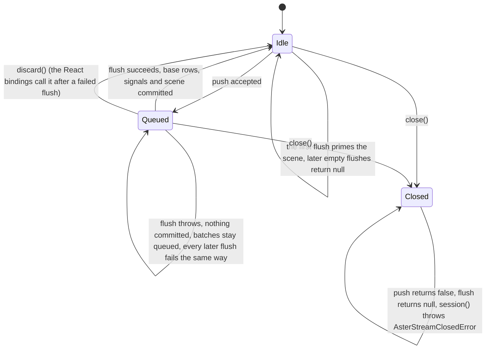

# Errors

Aster separates **host controls** (a budget, a URL policy, a backpressure bound) from **spec errors** and from
**recovered expression errors**. The first group has typed classes with stable `code`s; the rest are plain `Error`s
whose message starts with `[aster]` (or `[aster/vl]` for the Vega-Lite compiler).

```ts
import { AsterLimitError, renderSpec, type VgSpec } from '@aster-charts/core'

const untrustedSpec: VgSpec = {
  width: 100,
  height: 100,
  data: [{ name: 'table', values: Array.from({ length: 20 }, (_, i) => ({ i })) }],
  marks: [],
}

try {
  renderSpec(untrustedSpec, { limits: { maxRows: 10, maxTimeMs: 500 } })
} catch (err) {
  if (err instanceof AsterLimitError) {
    console.error(err.code)    // "ASTER_LIMIT"
    console.error(err.message) // "[aster] limit exceeded: maxRows 20 > 10"
  } else {
    throw err
  }
}
```

## What to do with an error

Catch the typed errors by `code` (see "`instanceof` or `code`?" below); everything else is a plain `Error` whose message starts with `[aster]`.

| You see | It means | You do |
|---|---|---|
| `AsterLimitError` (`ASTER_LIMIT`) | a `limits` budget was exceeded: rows, marks, depth, items, output size, or the wall-clock deadline | show an error state; raise the budget only for a spec you trust ([Budget errors](#budget-errors), `docs/LIMITS.md`) |
| `AsterUrlError` (`ASTER_URL_DENIED`) | the URL policy refused a URL (protocol, credentials, non-public host, relative URL, the `allow` hook), or `urlData: 'refuse'` refused a url dataset | fix the URL, or widen the policy deliberately; a refused url dataset is the host's rule, so give the spec inline rows ([URL errors](#url-errors)) |
| `AsterStreamBackpressureError` (`ASTER_STREAM_BACKPRESSURE`) | a `push` would overflow the queue under `policy: 'error'` | flush before pushing, slow the producer, or choose another policy ([Stream errors](#stream-errors)) |
| `AsterStreamClosedError` (`ASTER_STREAM_CLOSED`) | `stream.session()` was called after `close()` | stop using the stream after closing it |
| `SpecParseError` | the spec was refused when it was compiled, as `vega.parse` refuses it | fix the spec; the message is vega's ([Expressions are refused when the spec is compiled](#expressions-are-refused-when-the-spec-is-compiled)) |
| `ExpressionParseError` | an expression does not parse, or a function was removed after the compile | fix the expression or the registration |
| `VLCompileError` (`[aster/vl] <path>: <message>`) | the Vega-Lite spec has an unknown key or a feature `@aster-charts/vl` does not implement | fix the spec at `<path>` ([Deliberate differences from Vega](#deliberate-differences-from-vega)) |
| `[aster] ... load the addon first` | the spec needs an add-on that is not loaded, and the entry point cannot wait | `await loadAddonsFor(spec)`, or import the add-on ([Unsupported and unknown features](#unsupported-and-unknown-features)) |
| a report on `logger` | an expression threw at run time and the render carried on, as vega's does | route `logger` to your own log; the chart is partial ([Recovered expression errors](#recovered-expression-errors-logger)) |
| `<div role="alert">` in `<Chart>` | the render failed, or a limit was exceeded | read the message; `onError` receives the error ([Other runtime errors](#other-runtime-errors)) |

## Typed errors at a glance

| Class | From | `name` | `code` | Extra fields |
|---|---|---|---|---|
| `AsterLimitError` | `@aster-charts/core` | `AsterLimitError` | `ASTER_LIMIT` | none |
| `AsterUrlError` | `@aster-charts/core`, `@aster-charts/core/load` | `AsterUrlError` | `ASTER_URL_DENIED` | `url`, `reason` |
| `AsterStreamBackpressureError` | `@aster-charts/core` | `AsterStreamBackpressureError` | `ASTER_STREAM_BACKPRESSURE` | `bound` (`'batches'` or `'rows'`), `limit` |
| `AsterStreamClosedError` | `@aster-charts/core` | `AsterStreamClosedError` | `ASTER_STREAM_CLOSED` | none |
| `ExpressionParseError` | `@aster-charts/core` | `ExpressionParseError` | none | `expression`, `cause` |
| `SpecParseError` | `@aster-charts/core` | `SpecParseError` | none | `cause` |
| `VLCompileError` | `@aster-charts/vl` | `VLCompileError` | none | none |

Everything else the packages throw is a plain `Error` (or a `TypeError` for a malformed stream batch or worker
message) with an `[aster]` prefix and **no `code`**. Do not claim a `code` for an error that is not in this table.

### `instanceof` or `code`?

Prefer `err.code === 'ASTER_LIMIT'` (and the other codes) over `instanceof` whenever the error may have crossed a
boundary or come from a second copy of the package:

- The worker hooks (`useChartWorker`, `useChartWorkerStream`, `<ChartWorkerStream>`) rebuild the error from
  `{ name, message, code }` (`errorFromWire` in `@aster-charts/react/worker`). A limit error (`code: 'ASTER_LIMIT'`) comes
  back as a real `AsterLimitError`. **Every other class comes back as a plain `Error` with `name` and `code` copied
  over and none of its other fields**: an `AsterUrlError` loses `url` and `reason`, an
  `AsterStreamBackpressureError` loses `bound` and `limit`, so `instanceof AsterUrlError` is `false` there while
  `err.code === 'ASTER_URL_DENIED'` works.
- If you call `handleChartWorkerRequest` / `handleChartWorkerStreamRequest` yourself, or read `ChartWorkerResponse`
  messages directly, you get the wire form `error: { name, message, code? }`.
- Two copies of `@aster-charts/core` (a bundler duplicating a dependency) have two different `AsterLimitError` classes.

## Budget errors

`AsterLimitError` is thrown by `checkSpecLimits`, `checkSceneLimits`, `checkSvgLength` and `createLimitClock`, by
`loadSpecData` (timeouts, size, redirects), and by the meters inside transforms, the encode loop, guide generation,
expression builtins and the expression parser (see `docs/LIMITS.md`). Under a `limits` scope a violation raised
anywhere in a render is never swallowed by a defensive `catch`: the call fails with it. `<Chart>` renders
`<div role="alert">` containing the limit message instead of the chart, and reports the error through `onError`.

| Message fragment | Meaning |
|---|---|
| `maxRows`, `maxMarks`, `maxDepth`, `maxStringLength` | pre-flight spec budget; `maxRows` also caps any dataset a transform produces, `maxDepth` also covers expression nesting (`(expression nesting)`) and, with a cyclic spec, the separate message `spec contains a cycle` |
| `maxGeneratedRows`, `maxGeneratedBytes` | cumulative rows / characters generated during one evaluation |
| `maxItems`, `maxPathLength` | generated scene budget (also tick counts and generated paths) |
| `regexSafety: ...` | a regular expression pattern with a catastrophic-backtracking shape was refused (only under `limits`) |
| `timeoutMs`, `maxBytes`, `maxRedirects` | `loadSpecData` request caps |
| `maxSvgLength` | serialized output budget |
| `maxTimeMs exceeded during <phase>` | wall-clock deadline; the phase is `pre-flight`, `compile`, `evaluate`, `render`, `change`, `mark encoding`, `loadSpecData`, `regular expression` or the name of the transform that was running |

## URL errors

`AsterUrlError` (`code: 'ASTER_URL_DENIED'`, `url`, `reason`) means a URL was refused by the policy: protocol not
allowed, embedded credentials, non-public host, relative URL without `baseURL`, refused by the `allow` hook. It is
thrown by `loadSpecData` before the request is made, and by image and `href` marks under `urlPolicy` or `limits`
(unless `onDeny` is set, which drops the image or link instead). It is never recovered by the `logger` mechanism
below.

Under `urlData: 'refuse'` a spec with a url dataset is refused with an `AsterUrlError` before any add-on loads and before
evaluation: `[aster] url denied: dataset "source_0" loads its rows from a url, and url data is not allowed here (urlData:
"refuse"): <url>` (with several, `datasets "a", "b" load their rows from urls`; `url` is the first one's). An invalid `urlData`
is a `TypeError` (`[aster] urlData must be "allow" or "refuse", ...`).

## Stream errors

`createChartStream` throws two typed errors, each with a stable `code` (use the code, not `instanceof`, across a
worker boundary or duplicated bundles):

| Class | `code` | When |
|---|---|---|
| `AsterStreamBackpressureError` | `ASTER_STREAM_BACKPRESSURE` | `policy: 'error'` and a `push` would exceed `capacity` (batches, `bound: 'batches'`) or `maxQueuedRows` (rows, `bound: 'rows'`); `limit` is the configured bound |
| `AsterStreamClosedError` | `ASTER_STREAM_CLOSED` | `stream.session()` after `close()` (`push` returns `false` and `flush` returns `null` after close; neither throws) |

A batch that is not an object, or whose `data.<name>` / `append.<name>` is not an array, makes `push` throw a
`TypeError` (`[aster] stream batch must be an object`, `[aster] stream batch.append.<name> must be an array`).

A `flush()` that throws (any error, including `AsterLimitError`) leaves the stream
exactly as it was before the call, with its batches still queued, and rethrows the
original error.

- `getStreamFlushFailure(err)` returns `{ batches, queuedRows }` for such an error.
- `stream.discard()` drops the queued batches so the next flush can succeed (otherwise every later flush fails the same way).
- See "Atomic flush" and "Recovering from a failed flush" in `docs/API.md`.



*The stream queue (`createChartStream`). The queue and the committed rows change together or not at all.*

The React bindings do the discard for you:

- `useChartStream`, `useChartWorkerStream`, `<ChartStream>` and `<ChartWorkerStream>` call `stream.discard()` right after capturing a flush error, expose it as `error` together with `flushFailure: { batches, queuedRows, discarded }`, and clear both on the next successful flush.
- The components render `<div role="alert">` with the message and call `onStreamError(error, failure?)` once per error.
- With `policy: 'error'` a local `push` throws `AsterStreamBackpressureError` to the caller; with a Worker the producer-side buffer throws the same class before anything is posted.

## Recovered expression errors (`logger`)

An expression that throws **at run time** is not a host error and not a reason to fail the render: vega's dataflow logs
it and carries on with what it has computed, and so does the engine. The report goes to `RuntimeInput.logger` (a
vega-shaped `{ error, warn, info?, debug? }`; default `console`; `<Chart logger>` and `SignalEventHooks.logger` forward
it). Nothing is swallowed without a report, and each report is the original `Error`.

| Where the expression threw | What is left (as in vega) |
|---|---|
| a conditional-encode `test` or branch, a `signal` or `field` in an encode, of a mark or of a group item | the failing item keeps the channels evaluated before it; nothing later in the pass is made; the error is logged once ([details](#encode-failure-in-a-mark-or-group-item)) |
| an entry of a guide's encode (an axis part, a legend part, a title) | as the line above, in the guide: the channels written before the failing one stay, the items after it are unencoded, the marks of the guide that come after it are not made, nothing after the guide is |
| a `signal` or a scale of a group's scope | the instance of the scope is made without anything in it, and nothing after it |
| an entry that calls a scale the spec never declared (`{scale, field}`, `{scale, value}`, `{scale, signal}`, `{scale, range}`, the `extra` of a band) | `TypeError: _.%<name> is not a function`, then as the encode row above ([details](#reference-to-a-scale-the-spec-never-declared)) |
| a facet `cross` over a nested group-by path | the aggregate throws (`Cannot read properties of undefined`), the mark is not made and the run stops (as above) |
| a dataset transform (`filter`, `formula`, ...) | the dataset publishes no rows; marks sourced from it are not built |
| a mark-level `transform`, a mark `sort` (a group's too: a facet's cells, a header or footer group) | the mark is made in full, the error is logged once and the pass stops there: the marks after it, the legends and the title are not made ([details](#mark-transform-or-sort-failure)) |
| a signal of the view that reads data or a scale (or is declared after one that does) | everything that does not read the signal is made; what reads it is made bare; the error is logged once; nothing below the view is made ([details](#a-view-signal-that-reads-data-or-a-scale)) |
| a scale that cannot be built (bad `scheme`, unrecognised scale `type`, non-array `range`, ...) | the run stops there: this and later scales are absent and nothing is encoded |
| the `format` of an axis or a legend that its label format refuses (`zzz%%`, `{signal: '0/0'}`, `{}` for numbers; `true` for dates) | a refused format makes the guide's operator throw: logged once, the guide and what comes after it are not made ([details](#a-label-format-the-guide-refuses)) |
| a `{signal}` given to the ticks of an axis or the entries of a legend (`tickCount`, `values`, `tickMinStep`, `format`, `formatType`, `symbolLimit`, a band's `extra`) that throws | each is an operator of its own ranked just before the guide's: logged once, and the pass stops at the guide |
| a grid layout (`layout`) it cannot take: a `columns` that is no count (fractional, negative, text: `RangeError: Invalid array length`), a column header or footer with no cell at or before its place (`TypeError: Cannot read properties of undefined (reading 'x')`, `'bounds'` with a band); a symbol legend's `columns` that is no count | logged once; the pass stops at the layout, so no scope around the mark is laid out ([details](#a-grid-layout-that-cannot-be-laid-out)) |
| a `signal.on` filter or update, while an event is handled | that event's delivery stops (updates already applied stand); the next event works |

An evaluation that logged a recovery is not committed as the base of the next incremental one, so a following update
re-derives from scratch. Items an aborted run never encoded stay in their mark, without geometry or paint, as they do
in vega's scenegraph (what each mark type draws for one is compared with vega for every type).

**Never recovered** (rethrown to the caller): `AsterLimitError`, `AsterUrlError`, `SpecParseError`, an expression that
does not **parse** (`ExpressionParseError`; vega throws those from `vega.parse`), and any error whose message starts
with `[aster]` (usage errors, the unsupported-feature errors below). A handler of a signal that cannot be built (a
malformed event selector, a bad update, a bad filter) is not recovered either: it refuses the spec when it is compiled,
as `vega.parse` does (see "Expressions are refused when the spec is compiled" below). What is reported to the logger when
the handlers are bound is only what changed since the compile: a function the host registered and then removed.

```ts
import { renderSpec, type VgSpec } from '@aster-charts/core'

const reports: unknown[] = []
const spec: VgSpec = {
  width: 100,
  height: 100,
  data: [{ name: 'table', values: [{ a: 1 }, { a: 2 }], transform: [{ type: 'filter', expr: 'datum.a.b.c > 1' }] }],
  marks: [{ type: 'rect', from: { data: 'table' }, encode: { enter: { width: { value: 5 }, height: { value: 5 } } } }],
}
const svg = renderSpec(spec, {
  logger: { error: (e) => reports.push(e), warn: () => {} },
})
console.log(reports.length, svg.includes('<svg')) // 1 true: the filter failed, the run carried on
```

## Expressions are refused when the spec is compiled

`vega.parse` reads every expression of a spec before a view exists and refuses the spec, whole, at the first one it cannot
use. `compileChart` does the same, and so do `renderSpec`, `evaluateChart` of a spec, `useChart` and the mount of a `<Chart>`,
at the same time, in the same order, with the same message. The error is a `SpecParseError` (an `Error`; vega throws a
plain `Error`), thrown before anything is drawn and never recovered into a log entry. (The few refusals where vega fails with a
message of the JavaScript engine, a call such as `upper()` with no argument, are `TypeError`s with that message, as in vega.) In
the order vega meets them:

| An expression that has | The message |
|---|---|
| a syntax error | `Expression parse error: <the text vega parsed>`. The text is what vega built from the spec: the expression itself for a `signal`, `update`, `expr` or filter; `(signal)` or `_scale("x", (signal))+(offset)` for an encode entry; `(a)&&(b)` for the filters of a stream; `if(trigger,modify("d",...),0)` for a data trigger |
| a call that names data or a scale without a literal | `First argument to data functions must be a string literal.`, `First argument to indata must be a string literal.`, `Second argument to indata must be a string literal.`, `First argument to selection functions must be a string literal.` |
| a call of a function vega does not know | `Unrecognized function: <name>` |
| a call of something that is not a name, the identifier `_`, an object literal with a key every object has, `clamp` / `if` with other than three arguments | `Illegal callee type: <type>`, `Illegal identifier: _`, `Illegal property: <key>`, `Missing arguments to clamp function.` / `Too many arguments to if function.` |
| a name that is no signal of the scope | `Unrecognized signal name: "<name>"` |

The checks are made in that order within one expression (a syntax error before an unknown function, an unknown function
before an unknown signal) and the expressions are met in vega's order: a scope's data sets and their transforms, scales,
the signals with their handlers (the update, then the events, then the filters of each stream), axes, marks (a group's content
in its own scope), legends, the title, and last the `{signal: text}` properties whose text names no signal, which are
expressions of their own. A function is known when it is a built-in, a function registered with `registerExpressionFunction`,
one of the add-ons' (loaded or not: see below), `if`, or an event function; names with an underscore are unknown but the three
that vega's own encode entries are written with (`_scale`, `_bandwidth`, `_range`). A name is a signal of a scope when the spec,
its config or a transform with a `signal` declared it before the expression (or after it, for a `{signal: text}` property), in
that scope or one around it; a group also has `parent`, and a view has `width`, `height`, `padding`, `autosize` and
`background`. The names every object has (`toString`, `constructor`) are signals everywhere, as upstream.

Selectors and streams of a signal's `on` are refused the same way: `Signal update missing events specification.`, a
selector the parser refuses (`Between selector must have two elements: ...`), `Invalid stream specification: ...`,
`Stream "between" parameter must have 2 entries: ...`, `Unrecognized scale name: "<name>"` for a scale that triggers a
handler, `Signal encode and update are mutually exclusive.`, `Invalid signal update specification.`, and for the signal itself
`Signals can not include both init and update expressions.`.

**Add-on functions.** A function of an add-on (`geoCentroid`, `sampleNormal`, `treePath`, ...) is known to the compile whether
or not the add-on has been loaded: vega knows it, so the spec is not refused. When the add-on is not loaded the call fails
when it is evaluated with `[aster] this spec calls the expression function "<name>"; load the addon first: ...`, as an unloaded
transform does. `@aster-charts/core/addons` finds the add-on from the same expressions before the spec is compiled, so a host that
uses `loadAddonsFor`, `<Chart>` or the hooks never sees it. A spec that calls an unknown function *and* an add-on's is refused for
the unknown one, whichever comes first.

**Functions vega has and Aster does not implement** (`debug`, `info`, `warn`, `encode`, `flush`, `intersectLasso`,
`lassoAppend`, `lassoPath`, `screen`) are not refused at compile (vega accepts them); calling one fails when it is evaluated with
`Unrecognized function: <name>`. `isInvalid`, which Aster used to have and vega does not, is refused like any unknown function.

**Transforms** are read through their definition, as vega does: the parameters in the order the definition lists them (so with two
broken expressions in one transform the first of the definition is the one refused, whatever order the keys are written in), each by its
kind (a field or a value that takes `{expr: text}` is parsed, one that does not is not; `filter: {signal: ...}` is `Expression
references can not be signals.`), and a key the definition does not list is not read.

**Guides.** An axis, a legend and the title are read as vega reads them, mark by mark: an expression in a property of a mark the
guide does not have is not parsed, and so not refused (the `grid*` properties of an axis without gridlines, the `title*` ones of a
guide without a title, `gradient*` on a symbol legend, `symbolSize` when the legend has a scale for the size or the author's
`encode.symbols` sets it, `aria`, `description`, `zindex`, and the properties that only turn a feature on: `grid`, `ticks`,
`labels`, `domain`). The size a symbol legend gives its entries (`max(ceil(sqrt(<size>)+<stroke width>),<font size>)`) and the layout
of its entries (`gridAlign`, `rowPadding`, `columnPadding`) are written out and parsed as vega writes them, so a syntax error in
`symbolSize`, `symbolStrokeWidth`, `labelFontSize` or `gridAlign` is quoted as vega quotes it. **Not reproduced:** vega writes the
positions of a band, the offsets of ticks and labels, the flush of labels, the tick size, `gradientLength`, `gridScale`,
`symbolOffset` and the number of columns into longer expressions that depend on the config, the orient and the scale; Aster reads
them (an unknown function or signal in one is refused with vega's message) but quotes a syntax error in them as the author's text
alone (`(1 +)`, where vega gives `round(_scale("x", datum["value"])+_bandwidth("x")*((1 +))+0)`). The order of two broken properties
of one guide is that of the spec's keys, where vega's is that of the marks it makes.

**Names and parameters.** In the same walk, at the place vega meets them, the compile refuses what `vega.parse` refuses of the names a
spec uses and of the parameters of its transforms (`differential-transform-params` and `differential-parse-errors` generate these from the
pinned vega's definitions):

| What | The message |
|---|---|
| a transform without a parameter its definition requires (a sub-parameter object's too) | `Missing required "<type>" parameter: "<name>"` (a sub-parameter object names its own `type`, mostly `undefined`). A `bin` without `extent` is accepted: Aster derives it from the data (a deviation, see `docs/ARCHITECTURE.md`) |
| a lookup whose `from` is not a literal name | `Lookup "from" parameter must be a string literal.` |
| a data set no scope declared before (a lookup's `from`, a force's `links`, a kde distribution's `from`, `avoidMarks`, `from.data`, a facet's data, a `source`, a scale domain's) | `Undefined data set name: "<name>"` |
| a projection (`geopoint`, `geopath`, `geoshape`), the scale of an axis or of a legend's first channel, that the scope does not have | `Unrecognized scale name: "<name>"` (`undefined` when there is none) |
| a legend with no scale | `Missing valid scale for legend.` |
| a list parameter given as anything but a list or a `{signal}` | `TypeError: value.map is not a function` (`Cannot read properties of null (reading 'map')` for `null`) |
| sub-parameters (a force's `forces`, a density's `distribution`) not in a list, or of no known kind | `Expected an array of sub-parameters. Instead: <value>`, `Unsupported parameter: <value>` |
| a facet without a name, or without `groupby` or `field` | `Facet must have a name: <facet>`, `Facet must specify groupby or field: <facet>` |
| a signal pushed to an outer scope that no scope around declared before, or that says its own `value`, `update`, `init`, `react` or `bind` | `No prior signal definition for "outer" push: "<name>"`, `Invalid property  for "outer" push: "<property>"` |
| a discrete scale's domain sorted by an aggregate `op` (other than `count`) without a `field`; a `domainMin`/`domainMax` with no domain | `No field provided for sort aggregate op: <op>`, `No scale domain defined for domainMin/domainMax to override.` |

What the compile does not check: other refusals of `vega.parse` that are not about names or required parameters -- a name declared twice
in one scope as a signal, scale or projection (`Duplicate signal name`, `Duplicate scale or projection name`), an object where a scale
or projection property takes a value (`Unsupported object`, `Unsupported parameter object`), an unknown scale range (`Unrecognized scale
range value`, `Unsupported range type`), a field reference object of no known form (`Invalid field reference`), a binding on a group's
signal (`Nested signals do not support binding`), a mark trigger that inserts or removes (`Marks only support modify triggers.`), a
domain of several fields sorted by an op it cannot combine; that a data set named by `indata(...)` or a selection function exists; and
the sandbox's own cases: the names every object has (`toString`, `constructor`, `hasOwnProperty`) are
names like any other (upstream treats them as signals everywhere or fails on them with a message of the JavaScript engine).

## Unsupported and unknown features

Most of these are thrown by the **runtime** while the chart is evaluated, not by `compileChart`. Besides the expressions (see
above), the compiler checks the shape of the spec (`[aster] compileChart expects a Vega spec object`, `[aster] spec.scales must be
an array of scale definitions`, `[aster] a scale definition must be an object`) and, as `vega.parse` does, the names a spec uses:
an unknown transform `type` is a `SpecParseError` from `compileChart` (so from every host, before any data is read). The
rows below are plain `Error`s with an `[aster]` prefix and no `code`, thrown on the first `renderSpec`/`evaluateChart`.

| Situation | Error |
|---|---|
| unknown aggregate op | `[aster] unsupported aggregate op "bogus" (vega: AggregateOps[op] is not a function)` |
| `width` / `height` of the form `{ step }` | `[aster] width/height {step} sizing is not supported yet` |
| a geo projection used without the add-on | `[aster] this spec uses a geo projection; load the addon first: await import("@aster-charts/core/geo")` |
| a rare transform (`kde`, `linkpath`, `treemap`, ...) without the add-on | `[aster] this spec uses the "kde" transform; load the addon first: await import("@aster-charts/core/transforms")` |
| `csv`/`tsv`/`dsv`/`topojson` data format without the add-on | `[aster] this spec reads "csv" data; load the addon first: await import("@aster-charts/core/load")` |
| an unknown symbol `shape` (not a built-in name, not a valid SVG path) | `Invalid SVG path, incorrect parameter count` (the same message vega gives) |
| a Vega-Lite spec without the VL add-on (`<Chart>`, `useChart`, the worker handlers) | `A Vega-Lite spec was passed but the compiler is not loaded. Add ...` followed by the import to add, `import '@aster-charts/react/vl'` (no `[aster]` prefix) |

Load the matching add-on (`@aster-charts/core/geo`, `@aster-charts/core/transforms`, `@aster-charts/core/load`) before calling `renderSpec` or another synchronous entry point
(`await loadAddonsFor(spec)` from `@aster-charts/react`, or `loadAddons(missingAddons(spec))` from `@aster-charts/core/addons`, does it for you). The React shells, hooks and the worker entry
load them themselves ([how](ARCHITECTURE.md#geo-projections--the-add-on-boundary)); if that import fails the error is `[aster] could not load the "geo" add-on (@aster-charts/core/geo): <reason>`,
reported through `onError` (the hook's `error`), and it is remembered for the page (reload to retry).

### Deliberate differences from Vega

- **Unknown dataset and signal names are fatal.** An undeclared dataset used as a source (`from.data`,
  a scale domain) is `SpecParseError: Undefined data set name: "<name>"`, as `vega.parse`, from `compileChart` and so
  from every host. So is a name declared twice in one scope, `SpecParseError: Duplicate data set name: "<name>"`, with
  vega-parser's scoping: data sets, named marks, a facet's name, `root`, and every user-named mark a guide is made of
  (`encode.axis`, `encode.grid`, `encode.legend`, `encode.symbols`, ...) are data sets of the scope they are parsed in;
  a nested group owns its own names and may shadow its parents'. (Names such as `toString` crash vega's own parser;
  Aster does not reproduce that.) An unknown signal name is `SpecParseError: Unrecognized signal name: "<name>"` at the same
  time (see "Expressions are refused when the spec is compiled"). An unknown scale `type` is not fatal at compile: vega throws at parse
  time, Aster logs it and stops building scales (see the table above).
- **Spec lists follow vega-util `array()`.** `data`, `scales`, `marks`, ... may be a lone object (a one-element list)
  or `null` (empty), as in `vega-parser`: `data: { values: [...] }` is accepted.
- **Unknown expression functions are fatal, everywhere.** A call to a function vega does not know is
  `SpecParseError("Unrecognized function: <name>")` out of `compileChart`, in a formula, a filter, an encode `signal`, a signal
  `update` or the filter of an event stream alike, as vega's parser does. The functions vega has and Aster does not implement
  are the exception, and fail where they are called (see above).
- **Unknown projection type.** Without the geo add-on Aster throws the "load the addon" error above. With it, an
  unrecognised projection type throws `Unrecognized projection type: <type>` (a plain `Error` without the `[aster]`
  prefix) out of the render, where vega logs the same message and renders without the projection.
- **Vega-Lite is validated strictly.** `@aster-charts/vl` implements a subset of Vega-Lite and throws a `VLCompileError`
  (`[aster/vl] <path>: <message>`) for an unknown key (`unknown top-level property "foo"`), a config property it does
  not implement (`config.bogus: this config property is valid Vega-Lite but is not supported by @aster-charts/vl`), a
  feature it does not implement (`` a wrapped facet (a single `facet` field) around or inside another facet is not
  supported yet ``) and an unknown mark.
  vega-lite itself compiles the first three (it ignores the key or property) and crashes on the unknown mark.
- **Safety refusals.** Limits, the regular-expression screen, the URL policy, the hard spec-depth ceiling and the
  `bin`/`stratify` refusals are Aster additions; see `docs/LIMITS.md`.

### Known differences not yet matched

- **The numbers an `identifier` gives in nested scopes.** vega's `identifier` draws from one counter per view, in the order its
  dataflow runs: the datasets of the view, then its marks (a mark's transforms run on its items), then the scopes of its groups
  level by level, each instance's datasets before its marks. Aster numbers the view's datasets and marks in that order, and an
  item keeps its number from one evaluation to the next, as vega's does; but it builds what a group holds when it reaches the
  group, before the marks after it, so a mark inside a group numbers its items before a mark of the view written after the group
  (vega numbers them after), and the datasets of a group's scope number their rows from 1 for each instance (vega from the view's
  counter). Matching that needs the content of every group built after all the marks of its scope. The items a mark makes of rows
  that arrive together in data that unions several datasets are numbered in Aster's row order (the order of the datasets they
  come from), where vega's is the order the rows arrived in, pulse by pulse.

## Other runtime errors

- **Invalid URL/data** — `loadSpecData` rejects with `[aster] failed to load dataset url <url>: HTTP <status>`, an
  `AsterUrlError`, an `AsterLimitError` (timeout, size, redirects, rows), or a parse error such as `[aster] invalid
  JSON data: ...`.
- **Unloaded `url` dataset** — rendering a spec whose `url` dataset was never loaded throws `[aster] dataset "t" has a
  url but no data was loaded for it; resolve url datasets first: import { loadSpecData } from "@aster-charts/core/load" and
  render await loadSpecData(spec, { baseURL, ... }), or pass the rows as input.data["t"]`. Under `urlData: 'refuse'` the
  spec is refused before this, with an `AsterUrlError` ([URL errors](#url-errors)).
- **Stratify** — `[aster] stratify: cycle | multiple roots | missing: id | ambiguous: id | no root` (vega's messages
  with the prefix), and `[aster] stratify requires a key field`.
- **Circular data reference** — named datasets cannot form a cycle: `[aster] circular data reference: <name>`.
- **Scale domain with a non-string `data`** — `SpecParseError` (`Undefined data set name: ...`), as vega's parser.
- **Unknown expression function** — a call to a name that is not a built-in, a registered function (see
  `registerExpressionFunction`), an add-on's, `if` or an event function is `SpecParseError("Unrecognized function:
  <name>")` when the spec is compiled (see "Expressions are refused when the spec is compiled"). A function whose
  registration was disposed after the compile is `ExpressionParseError("Unrecognized function: <name>")` the next time an
  expression compiled earlier runs (a handler of a signal, bound after the disposal, reports it to the logger).
- **Expression functions** — `registerExpressionFunction` throws `[aster] registerExpressionFunction: "<name>" is not
  a plain identifier | is already an expression function, constant or keyword | needs a function`.
- **`bin`** — `[aster] bin: cannot derive a step size from base, maxbins and the data span` where vega would loop
  forever.
- **Render failure** — `<Chart>` renders `<div role="alert">` with `Chart render failed` (the message is in the
  `title`) or, for an `AsterLimitError`, the limit message itself, and calls `onError`; `useChart` returns `{ error }`
  (and `scene: null`).
- **Rejected `dataChanges`** — an unknown dataset, a non-integer or out-of-range index, or a changed row count makes
  `<Chart>` ignore the whole changeset (the update is diffed in full, the chart stays correct) and call `onError` with
  `[aster] dataChanges["<name>"]: ...`.
- **`@aster-charts/vl`** — `compile()` throws `VLCompileError` for anything it validates (see above).

## Worker errors

`@aster-charts/react/worker` answers a request with `{ id, error: { name, message, code? } }`; stream requests may add
`failure: { batches, queuedRows, discarded }`. The hooks rehydrate it with `errorFromWire` (see
[`instanceof` or `code`?](#instanceof-or-code) for what survives). In addition:

- A Worker `error` event ends the pending request with `Error('[aster] worker error: <message>')`, and a
  `messageerror` event with `Error('[aster] worker message could not be deserialized (messageerror)')`; a failing
  `postMessage` surfaces its own error. The hook's `error` is set and `pending` becomes `false`.
- A `textMetrics` object (or a `urlPolicy` with `allow`/`onDeny` functions) cannot be posted to a Worker: the hook
  fails with `[aster] a textMetrics provider object cannot be sent to a worker; register it in the worker with
  registerWorkerTextMetrics and pass its name` (respectively `... registerWorkerUrlPolicy ...`). An unregistered name
  fails in the worker with `[aster] unknown text-metrics provider "<name>" (register it with registerWorkerTextMetrics
  in the worker)` / `[aster] unknown url-policy hooks "<name>" ...`.
- The shipped worker entry (`@aster-charts/react/worker-entry`) validates messages: a request without a spec object, a stream
  request with a bad `op`, `streamId`, `batches` or `options` is answered with a `TypeError` wire error
  (`[aster] request needs a spec object`, ...); a message without a numeric `id` is dropped because there is nobody to
  answer; a flush for an unknown stream gives `[aster] unknown stream <id>`.

## Recovered expression errors in detail

What is left of a chart when an expression throws at run time follows vega-dataflow: its operators run in rank order and the pass stops at the first one that throws. The table under "Recovered expression errors (`logger`)" gives the outcome in a line; this section has the full account for the sites where it takes more than a line. "Scopes and an aborted pass" in [ARCHITECTURE.md](ARCHITECTURE.md) explains the ranking itself.

### Encode failure in a mark or group item

**Where the expression threw:** a conditional-encode `test` or branch, a `signal` or `field` in an encode, of a mark or of a group item.

**What is left (as in vega):**

- the failing item keeps the channels evaluated **before** the failing one (spec order); no later item, of this mark or any later one, is encoded or drawn (the run is aborted).
- The pass stops there as vega's does, and the error is logged **once**: the marks before the failing one in its scope were made, and so were its axes; its legends and title were not; the contents of the groups (and of the legend entries) of every scope, of this level or the ones below, are made after the scope, so none was made (see "Scopes and an aborted pass" in `ARCHITECTURE.md`)

### Reference to a scale the spec never declared

**Where the expression threw:** an entry that calls a scale the spec never declared (`{scale, field}`, `{scale, value}`, `{scale, signal}`, `{scale, range}`, the `extra` of a band).

**What is left (as in vega):**

- `TypeError: _.%<name> is not a function` (a `range`: `Cannot read properties of undefined (reading 'range')`), then as for any failing encode entry (the first two rows of the table).
- A band on its own reads a bandwidth of 0 and `{scale}` alone is 0, so neither fails.
- The message is vega's for a scale named in the spec; for one named by a signal or a field it is `_[("%" + <the reference>)] is not a function`

### Mark transform or sort failure

**Where the expression threw:** a mark-level `transform`, a mark `sort` (a group's too: a facet's cells, a header or footer group).

**What is left (as in vega):**

- vega runs them on the encoded items: the mark is made in full (the items in data order, with what the transforms before the failing one wrote), the error is logged once and the pass stops there, like a failing encode: the marks after it, the legends and the title are not made, nor what the group's items hold.
- An encode of the same mark that throws comes first: its error is the one logged, and the transforms and the sort never run

### A view signal that reads data or a scale

**Where the expression threw:** a signal of the view that reads data or a scale (or is declared after one that does).

**What is left (as in vega):**

- it is ranked after every other operator of the view's scope: everything that does not read it is made, what reads it (marks, and what reads them) is made bare (a mark whose encode reads it has its items as the join made them, and none of its transforms or its sort runs; one whose transform or sort reads it is encoded, and its transforms run up to the one that reads it), the layout of the view does not run when a mark reads it, the error is logged once and nothing below the view (the contents of its groups) is made.
- A guide or title of the view that reads it logs nothing of its own: what reads the signal gives nothing (in vega it never ran), so the one error is the signal's.
- An axis whose ticks read it (`tickCount`, `values`, `tickMinStep`, `format`, `formatType`, `tickExtra`) has no tick, label or grid marks at all: vega leaves their places in the axis empty and its own renderers cannot draw the view (`toSVG` rejects; a live view logs a second `TypeError` and stops drawing there, so what it shows depends on the renderer).
- Aster logs the error and then refuses the view with an `[aster]` error, as it refuses an axis over a scale ranked late in its own scope whose ticks fail (see "Scopes and an aborted pass" in `ARCHITECTURE.md`).
- Elsewhere the mark of the guide whose encode reads it (a title's text, a label's color or size, a legend's symbol size) has its items as the join made them, and so does every mark of the guide when it is the guide's group that reads it (an `offset`, a `padding`, a `translate`, a legend's `format`): vega's encoders of a guide's marks listen to the group's.
- The view is then not laid out, and the caption of a guide whose group was left so reads no orient and no format off it.
- A property a guide does not have (an axis's `columns`, a legend's `tickSize`) is never read, as in vega

### A label format the guide refuses

**Where the expression threw:** the `format` of an axis or a legend that its label format refuses (`zzz%%`, `{signal: '0/0'}`, `{}` for numbers; `true` for dates).

**What is left (as in vega):**

- the format and `formatType` are the values the guide's ticks (entries) operator is given -- a signal's whatever its type -- read through the scale's tick format: on a calendar (a `time`/`utc` scale or format type) a falsy specifier is the default multi-format, an object overrides it per unit, anything else is `Invalid time multi-format specifier: <value>`; elsewhere the text of the value is a number format (`42` is a width), and a scale with no tick format (ordinal, band) reads it only when it is truthy.
- A refusal (`invalid format: <text>`) makes that operator throw: logged once, the guide and what comes after it are not made (a gradient whose labels are ranked last keeps its gradient and title, and the rest of its scope is made).
- The caption of a guide whose group item holds a format the caption's format refuses is not written (no ARIA at all), as vega's

### A grid layout that cannot be laid out

**Where the expression threw:** a grid layout (`layout`) it cannot take: a `columns` that is no count (fractional, negative, text: `RangeError: Invalid array length`), a column header or footer with no cell at or before its place (`TypeError: Cannot read properties of undefined (reading 'x')`, `'bounds'` with a band); a symbol legend's `columns` that is no count.

**What is left (as in vega):**

- vega lays a group mark's items out one after the other, in one operator ranked after every instance below them: the error is logged once and the pass stops there.
- Everything below the items is made and laid out, the items before the failing one are laid out, the failing one only as far as its grid got (a bad count moves nothing; a header that finds no cell leaves the cells and the strips before it placed) and not its guides, the items after it not at all, and no scope around the mark is laid out (the view is not sized).
- More strips than the grid has columns (rows) is the warning `Grid headers exceed limit: <n>`, given each time the layout runs (in a view that fits its viewport, a group's layout runs again only when what it lays out changed)
